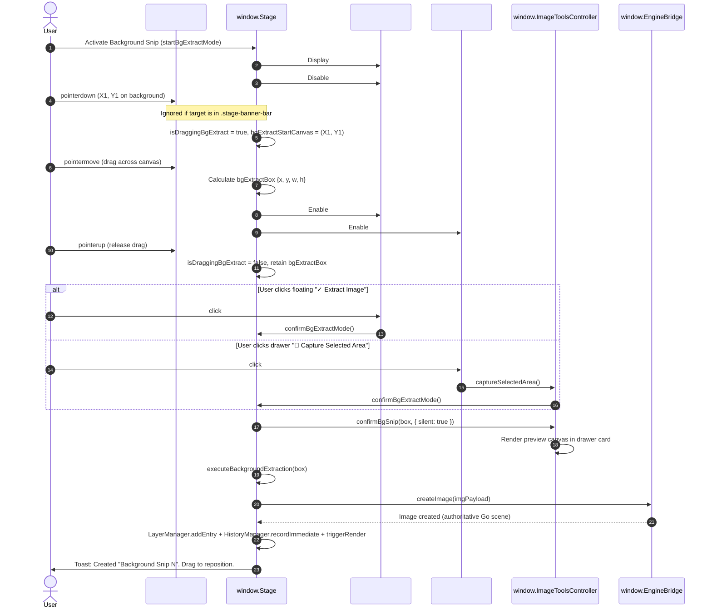
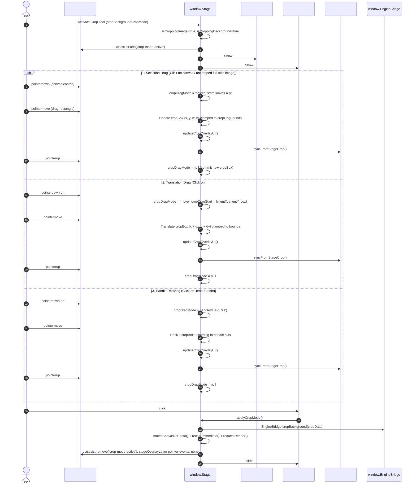

# SVG Animator Studio — Post-Carbon Remediation
## Batch 8F Interaction Event Map: Snip, Extract and Crop Overlay Pipelines

**Date:** 2026-11-12  
**Milestone:** Batch 8F  
**Scope:** Stage pointer routing, overlay hit-testing, and banner bar button dispatch

---

## 1. DOM Hierarchy & CSS Pointer Events Topology

```
#previewBox (.preview-wrapper, pointer-events: auto, cursor: crosshair)
│
├── #svgContainer (pointer-events: auto)
│   └── svg#mainSvg
│       └── rect#bgPhotoRect (rendered photo background)
│
├── #stageOverlayLayer (.stage-overlay-layer, pointer-events: auto during crop/clip, otherwise none)
│   │
│   └── svg#trajectorySvg (.trajectory-overlay, pointer-events: auto during crop/clip, otherwise none)
│       │
│       ├── g#cropOverlayGroup (display: block/none, pointer-events: auto)
│       │   ├── path#cropDimMask (fill: rgba(0,0,0,0.55), pointer-events: none)
│       │   ├── rect#cropBoxRect (fill: rgba(88,166,255,0.08), pointer-events="all", cursor: move)
│       │   ├── rect.crop-handle#cropHandle-nw (pointer-events="all", cursor: nwse-resize)
│       │   ├── rect.crop-handle#cropHandle-n  (pointer-events="all", cursor: ns-resize)
│       │   ├── rect.crop-handle#cropHandle-ne (pointer-events="all", cursor: nesw-resize)
│       │   ├── rect.crop-handle#cropHandle-e  (pointer-events="all", cursor: ew-resize)
│       │   ├── rect.crop-handle#cropHandle-se (pointer-events="all", cursor: nwse-resize)
│       │   ├── rect.crop-handle#cropHandle-s  (pointer-events="all", cursor: ns-resize)
│       │   ├── rect.crop-handle#cropHandle-sw (pointer-events="all", cursor: nesw-resize)
│       │   └── rect.crop-handle#cropHandle-w  (pointer-events="all", cursor: ew-resize)
│       │
│       ├── g#clipOverlayGroup (display: block/none, pointer-events: auto)
│       │   ├── path#clipDimMask (fill: rgba(0,0,0,0.45), pointer-events: none)
│       │   ├── rect#clipBoxRect (fill: rgba(56,211,159,0.08), pointer-events="all", cursor: move)
│       │   └── rect.clip-handle#clipHandle-* (pointer-events="all", cursor: directional)
│       │
│       └── rect#bgExtractBox (fill: rgba(88,166,255,0.2), stroke: #58a6ff, pointer-events: none)
│
├── #cropBar (.stage-banner-bar, z-index: 20, pointer-events: auto)
│   ├── #btnApplyCrop (✓ Apply Crop)
│   ├── #btnResetCropInBar (⟲ Reset)
│   └── #btnCancelCrop (✕ Cancel)
│
├── #clipBar (.stage-banner-bar, z-index: 20, pointer-events: auto)
│   ├── #btnApplyClip
│   ├── #btnResetClipInBar
│   └── #btnCancelClip
│
└── #bgExtractBar (.stage-banner-bar, z-index: 20, pointer-events: auto)
    ├── #btnConfirmExtract (✓ Extract Image)
    └── #btnCancelExtract (✕ Cancel)
```

---

## 2. Event Routing & State Transition Sequences

### 2.1 Snip / Extract Image Sequence (Problem A)



### 2.2 Background Crop Interactive Selection, Translation & Resizing (Problem B)



---

## 3. DOM & State Variable Reference Table

| Target Feature | DOM ID / Selector | Event Listener | Active State Variables | Invoked Action / Pipeline |
|---|---|---|---|---|
| **Snip Confirm (Floating)** | `#btnConfirmExtract` | `click` | `isExtractingBg: true`, `bgExtractBox` | `Stage.confirmBgExtractMode()` → `confirmBgSnip(box, {silent:true})` + `executeBackgroundExtraction(box)` |
| **Snip Cancel (Floating)** | `#btnCancelExtract` | `click` | `isExtractingBg: true` | `Stage.cancelBgExtractMode()` (hides `#bgExtractBar`, resets box) |
| **Snip Drawer Capture** | `#btnCaptureSelectedArea` | `click` | `isExtractingBg: true` | `ImageToolsController.captureSelectedArea()` → `Stage.confirmBgExtractMode()` |
| **Snip Drag Start** | `#previewBox` | `pointerdown` | `isExtractingBg: true` | `isDraggingBgExtract = true`, `bgExtractBox = {x, y, 0, 0}` (guarded against `.stage-banner-bar`) |
| **Snip Drag Move** | `#previewBox` | `pointermove` | `isDraggingBgExtract: true` | Updates `bgExtractBox`, updates `#bgExtractCoordsLabel`, enables `#btnConfirmExtract` & `#btnCaptureSelectedArea` (w>=10 && h>=10) |
| **Crop Drag-to-Select** | `#previewBox` | `pointerdown` | `isCroppingImage: true`, `isFullBox: true` or canvas click | `cropDragMode = 'select'`, stores `startCanvas` |
| **Crop Move Interior** | `#cropBoxRect` | `pointerdown` | `isCroppingImage: true`, `isFullBox: false` | `cropDragMode = 'move'`, stores `cropDragStart.box` |
| **Crop Handle Resize** | `.crop-handle` | `pointerdown` | `isCroppingImage: true` | `cropDragMode = handleId` (e.g. `se`, `nw`), stores `cropDragStart.box` |
| **Crop Pointermove** | `#previewBox` | `pointermove` | `cropDragMode: 'select'\|'move'\|handleId` | Updates `Stage.cropBox`, invokes `updateCropOverlayUI()` and `syncImageToolsFromCrop()` |
| **Crop Apply** | `#btnApplyCrop` / `#btnApplyCropInTools` | `click` | `isCroppingBackground: true`, `cropBox` | `Stage.applyCropMode()` → `EngineBridge.cropBackground(cropData)` |
| **Crop Cancel** | `#btnCancelCrop` / `#btnCancelCropInTools` | `click` | `isCroppingImage: true` | `Stage.cancelCropMode()` (restores overlay pointer-events to `none`, removes `crop-mode-active`) |
