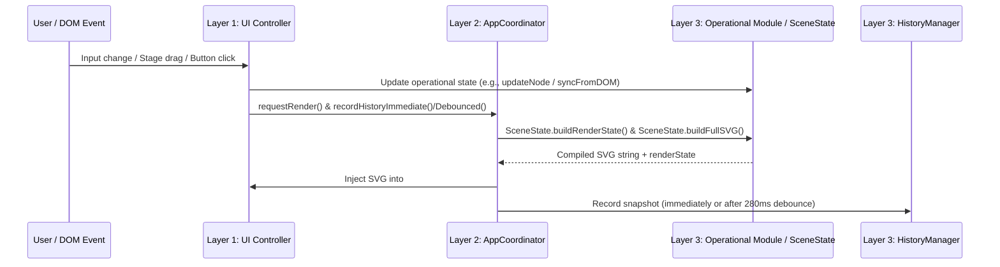

# Data Flow

## 1. Interactive Control & Object Update Flow

When a user interacts with a sidebar input or drags an object on the stage:

---

## 2. Master SVG Compilation Pipeline (`SceneState.buildFullSVG`)

Every render cycle constructs the complete SVG document through a deterministic operational pipeline in `internal/web/static/js/scene-state.js`:

1. **Canvas & Control State Resolution (`SceneState.buildRenderState()`):**
   - Resolves canvas width/height and background mode via `SceneState.buildCurrentCanvasState()` (using either the loaded photo dimensions/fit mode or blank canvas dimensions and grid pattern).
   - Reads camera rig (`static`, `ken-burns`, `handheld-drift`, `perspective-tilt`), optical filter (`none`, `focus-pull`, `tilt-shift`, `motion-blur`), and 3D frame overlay settings from `SceneState.controls`.
2. **Base SVG & Frame Construction (`Effects.build(state)`):**
   - Generates `<svg viewBox="0 0 w h">`, `<defs>` (viewport clip, background grid patterns or gradients, optical blur/mask filters, frame gradients, and `<style>` camera `@keyframes`), `.camera-stage-3d` / `.camera-rig` groups, background photo or canvas `<rect>`, and `#frameAssembly` overlay markup (`buildFrameMarkup`).
3. **Refractive Water Ripples (`Ripples.injectIntoSVG(svgString, state)`):**
   - Injects `<filter>` displacement maps and `<mask>` definitions into `<defs>` and injects animated elliptical ripple groups inside the camera rig.
4. **Hotspot Glows (`Glows.injectIntoSVG(svgString, width, height)`):**
   - Injects Gaussian blur filters into `<defs>` and renders pulsating orbs, radar sweep rings, or custom uploaded graphics inside the camera rig.
5. **Data Flows (`DataFlows.injectIntoSVG(svgString, state)`):**
   - Computes Bezier or orthogonal waypoint path strings (`generatePathString(flow.nodes, curviness, width, height, routingMode)`) from free percentage waypoints `{ x, y }`.
   - Injects glow filters into `<defs>`, renders track `<path>` elements, and attaches SMIL `<animateMotion>` / `<textPath>` payloads.
6. **Diagram Nodes (`DiagramNodes.injectIntoSVG(svgString, state)`):**
   - Injects `#node-drop-shadow` into `<defs>` and renders the 12 supported node geometries (`rounded`, `rect`, `pill`, `textbox`, `callout`, `diamond`, `hexagon`, `parallelogram`, `cylinder`, `cloud`, `circle`, `axes`), multiline text/subtext, and node animations (`none`, `pulse`, `float`, `breathe`, `glow`).

---

## 3. Undo/Redo & Project Persistence Flow

### Undo / Redo (`HistoryManager`)
1. `HistoryManager.captureSnapshot()` collects:
   - `controls`: Flat map of all 95 `trackedControlIds` (primitive `boolean`/`string` values) via `ControlStateAdaptor.syncFromDOM()` and `SceneState.getControlsSnapshot()`.
   - `loadedPhoto`: Photo descriptor from `SceneState.getLoadedPhoto()`.
   - `presets` and `autoApplyPreset`: From `NodePresets.getState()`.
   - `nodes` / `nodesCounter`, `flows` / `flowsCounter`, `glows` / `glowsCounter`, `ripples` / `ripplesCounter`: From each module's `getState()`.
2. On `undo()` or `redo()`, `HistoryManager.applySnapshot(snapStr)` sets `isRestoring = true`, restores `loadedPhoto`, syncs `controls` to `SceneState` and the DOM via `ControlStateAdaptor.syncToDOM()`, restores `NodePresets`, `DiagramNodes`, `DataFlows`, `Glows`, and `Ripples` via `setState()`, calls `NodePresets.syncAllRowsUI()` and `window.syncUIAfterHistoryRestore()`, and resets `isRestoring = false`.

### Project Save / Load (`ProjectManager`)
1. `ProjectManager.serializeStudioState()` constructs a schema `version: "1.2.0"` JSON string containing `controls`, `loadedPhoto`, `presets`, `autoApplyPreset`, `nodes`, `nodesCounter`, `flows`, `flowsCounter`, `glows`, `glowsCounter`, `ripples`, and `ripplesCounter`.
2. `POST /api/export/projects/save` (or `POST /api/projects`) persists `name`, `description`, `canvasWidth`, `canvasHeight`, `thumbnailB64`, and `schemaJson` in SQLite (`studio_library.db`).
3. Loading a project fetches the record via `GET /api/export/projects/get?id=...` (or `GET /api/projects/`), applies `schemaJson` via `ProjectManager.applyStudioState()`, clears `HistoryManager`, and records the loaded project as the new initial undo snapshot.

---

## 4. Export Flows

### Still / Print Export (`StillExportStudio`)
1. `StillExportStudio.buildStillRenderConfig(baseRenderState, exportOptions)` clones the render state, applies layer and effect toggle overrides, and generates the raw SVG via `window.buildFullSVG(payloadState, overrides)`.
2. `StillExportStudio.bakeStaticSVGAtTime(rawSvg, snapSec, targetW, targetH, forcePeakVis, enableFlows, enablePayloads)` parses the SVG into a temporary offscreen DOM container and evaluates SMIL `<animate>`, `<animateTransform>`, `<animateMotion>`, and CSS camera transforms at `t = snapSec` (using `evaluateSMILAnimate` and browser `getBBox()` measurements).
3. Exports standalone `.svg`, standalone `.html`, or rasterizes to `.png`, `.webp`, or `.jpg` via an HTML5 `<canvas>` (`buildStillBlob`).

### Animated Video / WebP / APNG Export (`AnimatedExportStudio` in `export-modal.js`)
1. `AnimatedExportStudio.constructExportJobPayload(baseState, config)` applies export overrides, builds the SVG via `window.buildFullSVG`, serializes it via `window.serializeSVGForExport(rawSvg)`, and returns `{ jobId, format, duration, fps, width, height, svgMarkup, audioB64, audioName, audioFit, state }`.
2. `POST /api/render` sends the payload to the Go backend (`internal/web/server.go`), which drives headless Chromium (`internal/rasterizer/`) and FFmpeg while reporting progress via `/api/render/progress`.
