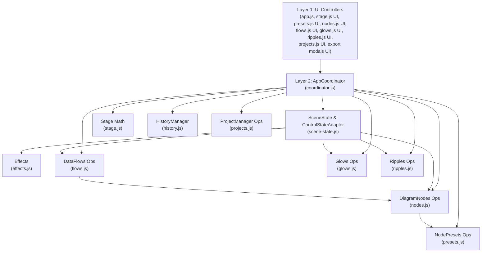

# Dependency Map

## 1. Script Load Order (`internal/web/static/index.html`)

The frontend uses browser globals loaded in a deterministic order at the bottom of `internal/web/static/index.html`:

| Order | Script Path | Global Symbol(s) | Primary Layer |
| :---: | :--- | :--- | :--- |
| 1 | `js/effects.js` | `window.Effects` | Layer 3 (Operational) |
| 2 | `js/scene-state.js` | `window.SceneState`, `window.ControlStateAdaptor` | Layer 3 (Operational + DOM Adaptor) |
| 3 | `js/coordinator.js` | `window.AppCoordinator` | Layer 2 (Application Coordination) |
| 4 | `js/stage.js` | `window.Stage` | Layer 3 (Math) + Layer 1 (Stage UI) |
| 5 | `js/presets.js` | `window.NodePresets` | Layer 3 (Preset Ops) + Layer 1 (Preset UI) |
| 6 | `js/nodes.js` | `window.DiagramNodes` | Layer 3 (Node Ops) + Layer 1 (Node UI) |
| 7 | `js/flows.js` | `window.DataFlows` | Layer 3 (Flow Ops) + Layer 1 (Flow UI) |
| 8 | `js/glows.js` | `window.Glows` | Layer 3 (Glow Ops) + Layer 1 (Glow UI) |
| 9 | `js/ripples.js` | `window.Ripples` | Layer 3 (Ripple Ops) + Layer 1 (Ripple UI) |
| 10 | `js/history.js` | `window.HistoryManager` | Layer 3 (History Stack) + Layer 1 (Undo/Redo Buttons) |
| 11 | `js/projects.js` | `window.ProjectManager` | Layer 3 (Serializer/REST) + Layer 1 (Library Modal UI) |
| 12 | `js/app.js` | `window.triggerAppRender`, `window.buildFullSVG`, etc. | Layer 1 (App UI Bindings & Compatibility Entrypoints) |
| 13 | `js/still-export-modal.js` | `window.StillExportStudio` | Layer 3 (SMIL Evaluator) + Layer 1 (Still Modal UI) |
| 14 | `js/export-modal.js` | `window.openExportModal`, `window.startExportJob`, etc. | Layer 3 (Payload Builder) + Layer 1 (Animated Modal UI) |

---

## 2. Allowed Dependency Graph

---

## 3. Dependency Rules

1. **No upward dependencies:** Operational methods in Layer 3 must never call `document.getElementById` or read/write DOM input values directly.
2. **No lateral UI coupling between object collections:**
   - Selecting a node in `DiagramNodes` must **not** directly mutate `DataFlows.activeFlowId`, `Glows.activeGlowId`, or `Ripples.activeRippleId`. Instead, selection transitions route through `AppCoordinator.selectObject(type, id, options)`.
   - `Stage` pointer/drag handlers delegate hit-testing and coordinate snapping through `AppCoordinator` and operational APIs rather than reading `#chkSnapToGrid` or mutating `DiagramNodes.nodes` directly.
3. **Allowed operational relationships:**
   - `DiagramNodes.getNodeEffectiveProps(node)` may query `NodePresets` operational state (`presetEnabled`, `presetValues`) to merge preset defaults when `node.usePreset` is `true`.
   - `DataFlows` path calculation (`getFlowEndpoints`, `generatePathString`) may query `DiagramNodes.getNode(id)` and `DiagramNodes.getNodeEffectiveProps(node)` to compute perimeter connection ports for attached nodes (`fromNodeId`, `toNodeId`).
   - `SceneState.buildFullSVG(state, overrides)` invokes `Effects.build`, `Ripples.injectIntoSVG`, `DiagramNodes.injectIntoSVG`, `DataFlows.injectIntoSVG`, and `Glows.injectIntoSVG` in sequence.
