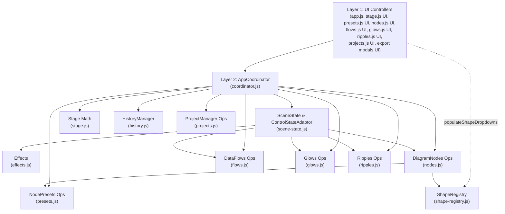

# Dependency Map

## 1. Script Load Order (`internal/web/static/index.html`)

The frontend uses browser globals loaded in a deterministic order at the bottom of `internal/web/static/index.html`:

| Order | Script Path | Global Symbol(s) | Primary Layer |
| :---: | :--- | :--- | :--- |
| 1 | `js/effects.js` | `window.Effects` | Layer 3 (Operational) |
| 2 | `js/scene-state.js` | `window.SceneState`, `window.ControlStateAdaptor` | Layer 3 (Operational + DOM Adaptor) |
| 3 | `js/coordinator.js` | `window.AppCoordinator` | Layer 2 (Application Coordination) |
| 4 | `js/stage.js` | `window.Stage` | Layer 3 (Math) + Layer 1 (Stage UI) |
| 5 | `js/shape-registry.js` | `window.ShapeRegistry` | Layer 3 (Operational) |
| 6 | `js/presets.js` | `window.NodePresets` | Layer 3 (Preset Ops) + Layer 1 (Preset UI) |
| 7 | `js/nodes.js` | `window.DiagramNodes` | Layer 3 (Node Ops) + Layer 1 (Node UI) |
| 8 | `js/flows.js` | `window.DataFlows` | Layer 3 (Flow Ops) + Layer 1 (Flow UI) |
| 9 | `js/glows.js` | `window.Glows` | Layer 3 (Glow Ops) + Layer 1 (Glow UI) |
| 10 | `js/ripples.js` | `window.Ripples` | Layer 3 (Ripple Ops) + Layer 1 (Ripple UI) |
| 11 | `js/history.js` | `window.HistoryManager` | Layer 3 (History Stack) + Layer 1 (Undo/Redo Buttons) |
| 12 | `js/projects.js` | `window.ProjectManager` | Layer 3 (Serializer/REST) + Layer 1 (Library Modal UI) |
| 13 | `js/app.js` | `window.WorkspaceController`, `window.openAccordionById`, `window.triggerRender`, `window.buildFullSVG`, `window.serializeSVGForExport`, `window.SVGExportAdapter`, etc. | Layer 1 (Workspace Controller, App UI Bindings, Export Adapter & Compatibility Entrypoints) |
| 14 | `js/still-export-modal.js` | `window.StillExportStudio` | Layer 3 (SMIL Evaluator & Still Config Builder) + Layer 1 (Still Modal UI) |
| 15 | `js/export-modal.js` | `window.AnimatedExportStudio`, `window.openExportModal` | Layer 3 (Payload Builder & REST Helpers) + Layer 1 (Animated Modal UI) |

---

## 2. Allowed Dependency Graph

---

## 3. Dependency Rules

1. **No upward dependencies in operational methods:** Layer 3 CRUD, geometry/coordinate calculation, and SVG builder methods do not call `document.getElementById` or read/write DOM input values directly. DOM control synchronization is handled through `ControlStateAdaptor` (`js/scene-state.js`).
2. **No lateral UI coupling between object collections:**
   - Selecting an object in `DiagramNodes`, `DataFlows`, `Glows`, or `Ripples` routes through `AppCoordinator.selectObject(type, id)` rather than directly mutating sibling modules' `activeId` properties or calling peer presentation methods.
   - Stage waypoint selection routes through `AppCoordinator.selectWaypoint(index)` and `DataFlows.selectWaypoint(index)`.
   - Stage viewport resizing and master SVG render cycles synchronize active overlays exclusively through `AppCoordinator.updateActiveOverlays()` rather than querying peer module state.
   - Coordinate snapping routes through `AppCoordinator.snapPosition(xPct, yPct)` (which delegates to `SceneState.getSnapConfig()` and `Stage.snapPctToGrid()`).
3. **Allowed operational relationships:**
   - `DiagramNodes.createNode(initialProps)` applies enabled preset properties via `NodePresets.applyToNodeObject(newNode)` when `applyPreset` (or `NodePresets.autoApplyToNewNodes`) is active, and snaps initial coordinates via `AppCoordinator.snapPosition`.
   - `DiagramNodes.injectIntoSVG(svgString, state)` delegates individual node shape path and geometry rendering to `ShapeRegistry.get(node.shape)`. If a node references an unknown or unregistered shape, it falls back gracefully without corrupting underlying data.
   - `DataFlows` waypoints use free percentage coordinates (`nodes: [{ x, y }, ...]`); `DataFlows.generatePathString(pts, curviness, w, h, routingMode)` and `DataFlows.injectIntoSVG(svgString, state)` are completely independent of `DiagramNodes`.
   - `SceneState.buildFullSVG(state, overrides)` invokes `Effects.build(state)`, `Ripples.injectIntoSVG(svgString, state)`, `Glows.injectIntoSVG(svgString, width, height)`, `DataFlows.injectIntoSVG(svgString, state)`, and `DiagramNodes.injectIntoSVG(svgString, state)` in sequence.
4. **Export XML serialization delegation:**
   - Layer 3 `SceneState.serializeSVGForExport(rawSvg)` contains no browser Web API calls (`DOMParser`/`XMLSerializer`); it delegates XML normalization and prolog injection to Layer 1 `window.SVGExportAdapter.serialize(rawSvg)`.
5. **Workspace Foundation & Interaction Refinement (Stage 3.1 & 3.2):**
   - Layer 1 `window.WorkspaceController` manages drawer collapse/expansion, dual vertical icon rails, section memory (`lastLeftAccId`/`lastRightAccId`), mobile responsive bounds, and maximized canvas mode.
   - Stage canvas resizing triggered by drawer transitions and window resize events synchronizes active overlays via `AppCoordinator.updateActiveOverlays()` and `Stage.syncOverlayBounds()` both synchronously and on `transitionend`.
   - Operational modules remain completely independent of drawer presentation state.
