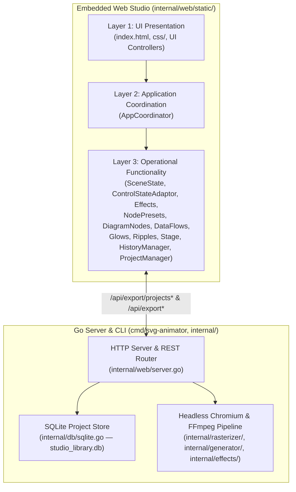

# Architecture Overview

## 1. System Summary

**SVG Animator Studio** is a self-hosted Go application and CLI tool (`cmd/svg-animator/main.go`) that embeds a vanilla HTML5/CSS3/ES6+ web studio (`internal/web/static/`) via `//go:embed`. It supports interactive creation of SVG diagrams, network topologies, data flow animations, refractive water ripples, radar pings/glows, optical filters, and 3D mitered frames, along with SQLite project persistence and multi-frame headless Chromium + FFmpeg exports.

---

## 2. Backend Architecture (`cmd/` & `internal/`)

### 2.1 Entrypoint (`cmd/svg-animator/main.go`)
- Parses command-line flags (`-studio`, `-port`, `-data-dir`, `-config`, plus CLI photo/frame/effect parameters).
- When launched with `-studio` (default in `build_and_run.sh`), initializes `web.StartServer(port, dataDir)`.
- When launched in CLI mode without `-studio`, generates standalone SVG/HTML/raster output using `internal/generator/` and `internal/rasterizer/`.

### 2.2 Embedded Web Server (`internal/web/server.go`)
- Embeds all files under `internal/web/static/` via `//go:embed static/*`.
- Initializes SQLite database at `<dataDir>/studio_library.db` via `db.InitDB(dataDir)`.
- Exposes REST endpoints:
  - `GET /api/export/projects` & `GET /api/projects` — List saved projects (`id`, `name`, `created_at`, `updated_at`, `thumbnail`).
  - `GET /api/export/projects/get?id=<id>` & `GET /api/projects/get?id=<id>` — Fetch full project including `schema_json`.
  - `POST /api/export/projects/save` & `POST /api/projects/save` — Insert or update a project record.
  - `POST /api/export/projects/delete?id=<id>` & `POST /api/projects/delete?id=<id>` — Delete a project record.
  - `POST /api/export` — Start an asynchronous multi-frame rasterization/encoding job (`webp`, `apng`, `mp4`, or `bundle`).
  - `GET /api/export/progress?jobId=<id>` — Server-Sent Events (SSE) progress stream for active export jobs.
  - `POST /api/export/cancel?jobId=<id>` — Cancel an active export job.
  - `GET /api/export/bundle?bundleId=<id>&fmt=<fmt>` — Download an individual output format from a completed bundle job.
  - `POST /api/export/audio/inspect` — Probe uploaded audio duration using `ffprobe`.

### 2.3 SQLite Persistence (`internal/db/sqlite.go`)
- Uses pure-Go `modernc.org/sqlite` in WAL mode (`PRAGMA journal_mode=WAL;`).
- Maintains two tables:
  - `projects (id INTEGER PRIMARY KEY AUTOINCREMENT, name TEXT NOT NULL, thumbnail TEXT, schema_json TEXT NOT NULL, created_at DATETIME, updated_at DATETIME)`
  - `assets (id TEXT PRIMARY KEY, mime_type TEXT NOT NULL, data BLOB NOT NULL, created_at DATETIME)`

---

## 3. Frontend Architecture (`internal/web/static/`)

The frontend runs inside `internal/web/static/index.html` and uses a three-column studio workspace:
- **Left Panel (`#leftPanel`):** Collapsible accordions for Source Image & Canvas, Optical Filters & Grading, Camera Rig & Pan/Zoom, Mitered 3D Frame, Refractive Water Ripples, and Hotspot Glows & Pings.
- **Center Stage (`#stageArea`):** Zoomable/pannable SVG preview canvas (`#canvasPreview`), stage overlays (`#reticleOverlay`, `#nodeOverlay`, `#flowOverlay`, `#glowOverlay`, `#rippleOverlay`), and top toolbar (Undo, Redo, Zoom controls, Snap-to-Grid, Project Library, Still Export, Animated Export).
- **Right Panel (`#rightPanel`):** Collapsible accordions for Node Preset Defaults, Diagram Nodes & Shapes, and Data Flows & Connectors.

All JavaScript modules are organized into three layers (`UI Presentation → Application Coordination → Operational Functionality`) detailed in [`application-layers.md`](application-layers.md).
