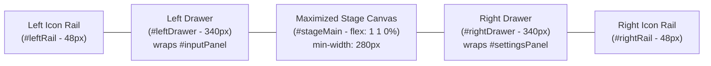

# Phase 3 Progress: Workspace Redesign

## 1. Executive Summary

Phase 3 transitions SVG Animator Studio from a rigid 3-column desktop layout into a modular, responsive workspace inspired by modern digital content creation tools (such as Blender).

**Stage 3.1 (Workspace Foundation, Icon Rails and Sliding Drawers)** establishes the core workspace layout, sliding drawers, dual vertical icon rails, and maximized canvas mode while strictly preserving all existing functionality, DOM element IDs, 95 tracked controls, SQLite persistence, and history tracking.

| Stage | Focus Area | Status | Architectural Health |
| :--- | :--- | :--- | :--- |
| **Stage 3.1** | **Workspace Foundation, Icon Rails & Sliding Drawers** | **Implemented** | 9 PASS, 1 WARNING (`ARCH-05` deferred), 0 FAIL |
| **Stage 3.2** | Floating Contextual Property Inspectors | Planned | Preserves operational APIs |
| **Stage 3.3** | Canvas HUD & Viewport Controls | Planned | Minimal non-intrusive stage controls |

---

## 2. Stage 3.1 Architectural Structure

### 2.1 Layer Division
In strict compliance with `AGENTS.md` Section 4 (`UI → Application Coordination → Operational Functionality`):
- **Layer 1 (UI Presentation):** `window.WorkspaceController` manages drawer states, rail button synchronization, maximize/restore transitions, and keyboard event routing in `internal/web/static/js/app.js`. CSS flexbox layout and sliding transforms are isolated in `internal/web/static/css/style.css`.
- **Layer 2 (Application Coordination):** `window.AppCoordinator` continues to handle cross-module selection, waypoint routing, and active overlay synchronization (`AppCoordinator.updateActiveOverlays()`). When drawers expand or collapse, the viewport HUD and overlays are updated immediately and on CSS transition completion.
- **Layer 3 (Operational Core):** All operational modules (`SceneState`, `Effects`, `DiagramNodes`, `DataFlows`, `Glows`, `Ripples`, `ShapeRegistry`, `NodePresets`, `HistoryManager`, `ProjectManager`) remain completely untouched and unaware of workspace drawer states.

### 2.2 DOM & Layout Hierarchy (`index.html`)
The studio layout now consists of a 5-column horizontal flexbox structure:

- **Header (`<header class="app-header">`):**
  - Added `#btnMaximizeCanvas` alongside Project Library and Export buttons.
- **Left Icon Rail (`<aside class="icon-rail icon-rail-left" id="leftRail">`):**
  - Canvas & Grid (`acc-background`)
  - Diagram Shapes & Text (`acc-nodes`)
  - Shape Presets (`acc-presets`)
  - Data Flows & Connectors (`acc-flows`)
  - Pulsating Glows (`acc-glows`)
  - Water Ripples (`acc-ripples`)
  - Left Drawer Toggle Button (`#railBtn-toggleLeft`)
- **Left Drawer (`<aside class="drawer left-drawer" id="leftDrawer">`):**
  - Drawer Header with title and collapse button (`#btnCollapseLeftDrawer`)
  - Unmodified `#inputPanel` container preserving all child accordion sections and IDs.
- **Central Stage (`<main class="stage" id="stageMain" role="main">`):**
  - Semantic `<main>` container with `flex: 1 1 0%` and `min-width: 280px`.
  - Automatically claims all available width when either or both drawers are collapsed.
- **Right Drawer (`<aside class="drawer right-drawer" id="rightDrawer">`):**
  - Drawer Header with title and collapse button (`#btnCollapseRightDrawer`)
  - Unmodified `#settingsPanel` container preserving all child accordion sections and IDs.
- **Right Icon Rail (`<aside class="icon-rail icon-rail-right" id="rightRail">`):**
  - Playback & Timeline (`acc-playback`)
  - Camera Framing (`acc-camera`)
  - Optics & Frame (`acc-optics`)
  - 3D Mitered Frame (`frame` — auto-opens Optics and expands Frame group)
  - Video & Still Export (`acc-export`)
  - Right Drawer Toggle Button (`#railBtn-toggleRight`)

---

## 3. Responsive Breakpoints & Viewport Behavior

1. **Wide Desktop (≥ 1440px):**
   - Both drawers can remain open simultaneously.
   - Stage expands to fill remaining central space.
2. **Compact Desktop (1024px – 1439px):**
   - Opening one drawer automatically closes the opposite drawer to guarantee ample central canvas space (at least 550px viewport width for diagram interaction).
3. **Tablet & Slide-over (< 1024px):**
   - Drawers switch to absolute slide-over positioning above the canvas (`z-index: 80`) with a dark semi-transparent backdrop (`#drawerBackdrop`).
   - Drawers default to collapsed state on initial load.
   - Clicking the backdrop or pressing `Escape` closes any active slide-over drawer.
4. **Reduced Motion (`prefers-reduced-motion: reduce`):**
   - Disables sliding transitions (`transition: none !important`), collapsing and expanding drawers instantaneously.

---

## 4. Interaction & Accessibility Features

### 4.1 Rail Navigation & Accordion Sync
- Clicking any rail button toggles or focuses the matching accordion section.
- If the corresponding drawer is collapsed, `window.openAccordionById(accId)` automatically expands the drawer, activates the rail button, and expands the accordion section.
- Active accordion states synchronize bidirectionally with rail button `.active` classes.

### 4.2 Maximized Canvas Mode
- Activated via header button `#btnMaximizeCanvas` or shortcut `Shift+Space`.
- Remembers the previous open/closed states of both drawers (`savedLeftState`, `savedRightState`).
- Collapses both drawers simultaneously to maximize working area.
- Exited via `#btnMaximizeCanvas`, `Shift+Space`, or `Escape`, cleanly restoring the previous drawer states.

### 4.3 Keyboard Shortcuts
- `T` — Toggle Left Drawer (Tools / Shapes).
- `N` — Toggle Right Drawer (Properties / Timeline).
- `Shift+Space` — Toggle Maximized Canvas Mode.
- `Escape` — Exit Maximized Canvas Mode, or close active slide-over drawer on compact screens.
- **Strict Input Suppression:** All shortcuts are suppressed when typing in `input`, `textarea`, `select`, or `contenteditable` elements, or when any modal dialog (`#projectsModal`, `#stillExportModal`, `#exportModal`) is open.

### 4.4 Accessibility (ARIA)
- All rail buttons provide explicit `aria-label`, `aria-controls`, and `aria-expanded` attributes.
- Collapsed drawers receive `aria-hidden="true"`, preventing screen-reader focus traps.
- Semantic HTML tags (`<header>`, `<aside>`, `<main>`) enforce proper document landmark hierarchy.

### 4.5 Stage 3.1 Review Remediation
1. **Responsive Drawer Backdrop (`#drawerBackdrop`):**
   - Present as exactly one `

` in `index.html`.
   - On viewports `< 1024px`, appears whenever a slide-over drawer is open (`z-index: 30`, `rgba(0, 0, 0, 0.65)`), sitting above the canvas but behind the rails (`z-index: 35`) and drawers (`z-index: 40`).
   - Clicking the backdrop safely closes the open drawer(s), updates ARIA attributes, and deactivates the backdrop without altering selection, zoom, or canvas state.
   - Hidden on desktop (`min-width: 1024px`) via `display: none !important;`.
   - Disabled transitions under `prefers-reduced-motion: reduce`.
2. **Focus Restoration on Drawer Collapse:**
   - When `closeLeftDrawer()` or `closeRightDrawer()` is triggered while `document.activeElement` is inside the collapsing drawer, focus is safely redirected to `#railBtn-toggleLeft` or `#railBtn-toggleRight`.
   - When entering maximized canvas mode, if focus was inside either drawer, focus is shifted to `#btnMaximizeCanvas`.
   - If focus was already outside the drawer (e.g. on stage, header, or rail), focus is preserved and not stolen.
3. **Optics vs Frame Rail Disambiguation & State Preservation:**
   - `#railBtn-optics` uses `data-target-acc="acc-optics"`.
   - `#railBtn-frame` uses `data-target-acc="acc-frame"` and controls `acc-optics` (`aria-controls="acc-optics"`).
   - `syncRailForAccordion()` activates only the targeted button, eliminating dual-active highlights.
   - Calling `openAccordionById('acc-frame')` opens the parent drawer, expands `#acc-optics`, scrolls the Frame controls into view without mutating `chkModuleFrame.checked` (presentation-only navigation), and activates only `#railBtn-frame`.
   - Calling `openAccordionById('acc-optics')` (or alias `'acc-optical'`) activates only `#railBtn-optics`.
   - Navigation across rails and accordions is strictly presentation-only and never modifies project state, tracked controls, or undo history.

---

## 5. Verification & Test Coverage

Stage 3.1 changes were verified across multiple automated test layers:

1. **Static Architecture Verification (`verify-architecture.sh`):**
   - 9 PASS, 1 WARNING (`ARCH-05` known exception), 0 FAIL.
   - Confirmed zero direct DOM queries in Layer 3.
   - Confirmed strict boundary adherence for `WorkspaceController` in Layer 1.
2. **Regression Harness (`regression-harness.js`):**
   - `WorkspaceController` open/close/toggle methods verified.
   - Independent drawer states on wide viewports verified.
   - Auto-collapse of opposite drawer on compact viewports verified.
   - Rail active synchronization and `openAccordionById` drawer un-collapsing verified.
   - Maximized canvas toggle and state restoration verified.
   - Keyboard shortcuts (`T`, `N`, `Shift+Space`, `Escape`) verified.
   - Shortcut suppression in editable controls and open modals verified.
   - Tracked control verification: all 95 control IDs in `HistoryManager.trackedControlIds` verified present in `index.html`.
   - ID collision check: zero duplicate IDs across `index.html`.
   - Script tag check: all 15 `<script>` tags verified in exact dependency order.
3. **Go Backend Verification:**
   - `go vet ./...` passed with zero warnings.
   - `go test ./...` passed all packages (`internal/db`, `internal/web`).
4. **Git Hygiene:**
   - `git diff --check` passed with zero whitespace or line-ending errors.
   - Protected deployment files (`Linux_Binary_Deployment_Guide.md`, `Windows_Binary_Deployment_Guide.md`, `build_and_run.bat`, `build_and_run.sh`) remained completely untouched and unstaged.

---

## 6. Runtime Constraints & Preserved Processes

- **Active Background Server:** `./svg-animator -datadir /tmp/svg-animator-smoke -port 8088` (daemon task-153) is active and running.
- **Process Protection:** The running process was not stopped, killed, restarted, or replaced.
- **Executable & Datadir Protection:** `./svg-animator` executable was not overwritten or rebuilt; `/tmp/svg-animator-smoke` was not touched. No secondary server was launched.
- **Verification Note:** Live in-process assets on port 8088 reflect the baseline at startup; browser-based verification requiring binary rebuild or server restart remains deferred until explicitly authorised.
