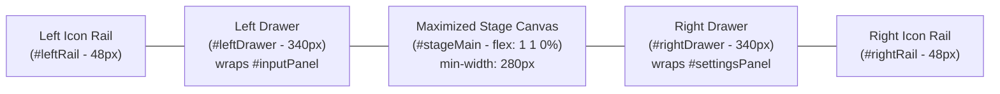

# Phase 3 Progress: Workspace Redesign

## 1. Executive Summary

Phase 3 transitions SVG Animator Studio from a rigid 3-column desktop layout into a modular, responsive workspace inspired by modern digital content creation tools (such as Blender).

**Stage 3.1 (Workspace Foundation, Icon Rails and Sliding Drawers)** establishes the core workspace layout, sliding drawers, dual vertical icon rails, and maximized canvas mode while strictly preserving all existing functionality, DOM element IDs, 95 tracked controls, SQLite persistence, and history tracking.

| Stage | Focus Area | Status | Architectural Health |
| :--- | :--- | :--- | :--- |
| **Stage 3.1** | **Workspace Foundation, Icon Rails & Sliding Drawers** | **Implemented** | 9 PASS, 1 WARNING (`ARCH-05` deferred), 0 FAIL |
| **Stage 3.2** | **Workspace Interaction & Responsive Layout Refinement** | **Implemented** | 9 PASS, 1 WARNING (`ARCH-05` deferred), 0 FAIL |
| **Stage 3.3** | Canvas HUD & Viewport Controls | Planned | Minimal non-intrusive stage controls |

---

## 2. Stage 3.1 Architectural Structure

### 2.1 Layer Division
In strict compliance with `AGENTS.md` Section 4 (`UI → Application Coordination → Operational Functionality`):
- **Layer 1 (UI Presentation):** `window.WorkspaceController` manages drawer states, rail button synchronization, maximize/restore transitions, and keyboard event routing in `internal/web/static/js/app.js`. CSS flexbox layout and sliding transforms are isolated in `internal/web/static/css/style.css`.
- **Layer 2 (Application Coordination):** `window.AppCoordinator` continues to handle cross-module selection, waypoint routing, and active overlay synchronization (`AppCoordinator.updateActiveOverlays()`). When drawers expand or collapse, the viewport HUD and overlays are updated immediately and on CSS transition completion.
- **Layer 3 (Operational Core):** All operational modules (`SceneState`, `Effects`, `DiagramNodes`, `DataFlows`, `Glows`, `Ripples`, `ShapeRegistry`, `NodePresets`, `HistoryManager`, `ProjectManager`) remain completely untouched and unaware of workspace drawer states.

### 2.2 DOM & Layout Hierarchy (`index.html`)
The studio layout now consists of a 5-column horizontal flexbox structure:

- **Header (`<header class="app-header">`):**
  - Added `#btnMaximizeCanvas` alongside Project Library and Export buttons.
- **Left Icon Rail (`<aside class="icon-rail icon-rail-left" id="leftRail">`):**
  - Canvas & Grid (`acc-background`)
  - Diagram Shapes & Text (`acc-nodes`)
  - Shape Presets (`acc-presets`)
  - Data Flows & Connectors (`acc-flows`)
  - Pulsating Glows (`acc-glows`)
  - Water Ripples (`acc-ripples`)
  - Left Drawer Toggle Button (`#railBtn-toggleLeft`)
- **Left Drawer (`<aside class="drawer left-drawer" id="leftDrawer">`):**
  - Drawer Header with title and collapse button (`#btnCollapseLeftDrawer`)
  - Unmodified `#inputPanel` container preserving all child accordion sections and IDs.
- **Central Stage (`<main class="stage" id="stageMain" role="main">`):**
  - Semantic `<main>` container with `flex: 1 1 0%` and `min-width: 280px`.
  - Automatically claims all available width when either or both drawers are collapsed.
- **Right Drawer (`<aside class="drawer right-drawer" id="rightDrawer">`):**
  - Drawer Header with title and collapse button (`#btnCollapseRightDrawer`)
  - Unmodified `#settingsPanel` container preserving all child accordion sections and IDs.
- **Right Icon Rail (`<aside class="icon-rail icon-rail-right" id="rightRail">`):**
  - Playback & Timeline (`acc-playback`)
  - Camera Framing (`acc-camera`)
  - Optics & Frame (`acc-optics`)
  - 3D Mitered Frame (`frame` — auto-opens Optics and expands Frame group)
  - Video & Still Export (`acc-export`)
  - Right Drawer Toggle Button (`#railBtn-toggleRight`)

---

## 3. Responsive Breakpoints & Viewport Behavior

1. **Wide Desktop (≥ 1440px):**
   - Both drawers can remain open simultaneously.
   - Stage expands to fill remaining central space.
2. **Compact Desktop (1024px – 1439px):**
   - Opening one drawer automatically closes the opposite drawer to guarantee ample central canvas space (at least 550px viewport width for diagram interaction).
3. **Tablet & Slide-over (< 1024px):**
   - Drawers switch to absolute slide-over positioning above the canvas (`z-index: 80`) with a dark semi-transparent backdrop (`#drawerBackdrop`).
   - Drawers default to collapsed state on initial load.
   - Clicking the backdrop or pressing `Escape` closes any active slide-over drawer.
4. **Reduced Motion (`prefers-reduced-motion: reduce`):**
   - Disables sliding transitions (`transition: none !important`), collapsing and expanding drawers instantaneously.

---

## 4. Interaction & Accessibility Features

### 4.1 Rail Navigation & Accordion Sync
- Clicking any rail button toggles or focuses the matching accordion section.
- If the corresponding drawer is collapsed, `window.openAccordionById(accId)` automatically expands the drawer, activates the rail button, and expands the accordion section.
- Active accordion states synchronize bidirectionally with rail button `.active` classes.

### 4.2 Maximized Canvas Mode
- Activated via header button `#btnMaximizeCanvas` or shortcut `Shift+Space`.
- Remembers the previous open/closed states of both drawers (`savedLeftState`, `savedRightState`).
- Collapses both drawers simultaneously to maximize working area.
- Exited via `#btnMaximizeCanvas`, `Shift+Space`, or `Escape`, cleanly restoring the previous drawer states.

### 4.3 Keyboard Shortcuts
- `T` — Toggle Left Drawer (Tools / Shapes).
- `N` — Toggle Right Drawer (Properties / Timeline).
- `Shift+Space` — Toggle Maximized Canvas Mode.
- `Escape` — Exit Maximized Canvas Mode, or close active slide-over drawer on compact screens.
- **Strict Input Suppression:** All shortcuts are suppressed when typing in `input`, `textarea`, `select`, or `contenteditable` elements, or when any modal dialog (`#projectsModal`, `#stillExportModal`, `#exportModal`) is open.

### 4.4 Accessibility (ARIA)
- All rail buttons provide explicit `aria-label`, `aria-controls`, and `aria-expanded` attributes.
- Collapsed drawers receive `aria-hidden="true"`, preventing screen-reader focus traps.
- Semantic HTML tags (`<header>`, `<aside>`, `<main>`) enforce proper document landmark hierarchy.

### 4.5 Stage 3.1 Review Remediation
1. **Responsive Drawer Backdrop (`#drawerBackdrop`):**
   - Present as exactly one `

` in `index.html`.
   - On viewports `< 1024px`, appears whenever a slide-over drawer is open (`z-index: 30`, `rgba(0, 0, 0, 0.65)`), sitting above the canvas but behind the rails (`z-index: 35`) and drawers (`z-index: 40`).
   - Clicking the backdrop safely closes the open drawer(s), updates ARIA attributes, and deactivates the backdrop without altering selection, zoom, or canvas state.
   - Hidden on desktop (`min-width: 1024px`) via `display: none !important;`.
   - Disabled transitions under `prefers-reduced-motion: reduce`.
2. **Focus Restoration on Drawer Collapse:**
   - When `closeLeftDrawer()` or `closeRightDrawer()` is triggered while `document.activeElement` is inside the collapsing drawer, focus is safely redirected to `#railBtn-toggleLeft` or `#railBtn-toggleRight`.
   - When entering maximized canvas mode, if focus was inside either drawer, focus is shifted to `#btnMaximizeCanvas`.
   - If focus was already outside the drawer (e.g. on stage, header, or rail), focus is preserved and not stolen.
3. **Optics vs Frame Rail Disambiguation & State Preservation:**
   - `#railBtn-optics` uses `data-target-acc="acc-optics"`.
   - `#railBtn-frame` uses `data-target-acc="acc-frame"` and controls `acc-optics` (`aria-controls="acc-optics"`).
   - `syncRailForAccordion()` activates only the targeted button, eliminating dual-active highlights.
   - Calling `openAccordionById('acc-frame')` opens the parent drawer, expands `#acc-optics`, scrolls the Frame controls into view without mutating `chkModuleFrame.checked` (presentation-only navigation), and activates only `#railBtn-frame`.
   - Calling `openAccordionById('acc-optics')` (or alias `'acc-optical'`) activates only `#railBtn-optics`.
   - Navigation across rails and accordions is strictly presentation-only and never modifies project state, tracked controls, or undo history.

---

## 5. Verification & Test Coverage

Stage 3.1 changes were verified across multiple automated test layers:

1. **Static Architecture Verification (`verify-architecture.sh`):**
   - 9 PASS, 1 WARNING (`ARCH-05` known exception), 0 FAIL.
   - Confirmed zero direct DOM queries in Layer 3.
   - Confirmed strict boundary adherence for `WorkspaceController` in Layer 1.
2. **Regression Harness (`regression-harness.js`):**
   - `WorkspaceController` open/close/toggle methods verified.
   - Independent drawer states on wide viewports verified.
   - Auto-collapse of opposite drawer on compact viewports verified.
   - Rail active synchronization and `openAccordionById` drawer un-collapsing verified.
   - Maximized canvas toggle and state restoration verified.
   - Keyboard shortcuts (`T`, `N`, `Shift+Space`, `Escape`) verified.
   - Shortcut suppression in editable controls and open modals verified.
   - Tracked control verification: all 95 control IDs in `HistoryManager.trackedControlIds` verified present in `index.html`.
   - ID collision check: zero duplicate IDs across `index.html`.
   - Script tag check: all 15 `<script>` tags verified in exact dependency order.
3. **Go Backend Verification:**
   - `go vet ./...` passed with zero warnings.
   - `go test ./...` passed all packages (`internal/db`, `internal/web`).
4. **Git Hygiene:**
   - `git diff --check` passed with zero whitespace or line-ending errors.
   - Protected deployment files (`Linux_Binary_Deployment_Guide.md`, `Windows_Binary_Deployment_Guide.md`, `build_and_run.bat`, `build_and_run.sh`) remained completely untouched and unstaged.

---

## 6. Runtime Constraints & Preserved Processes

- **Active Background Server:** `./svg-animator -datadir /tmp/svg-animator-smoke -port 8088` (daemon task-153) is active and running.
- **Process Protection:** The running process was not stopped, killed, restarted, or replaced.
- **Executable & Datadir Protection:** `./svg-animator` executable was not overwritten or rebuilt; `/tmp/svg-animator-smoke` was not touched. No secondary server was launched.
- **Verification Note:** Live in-process assets on port 8088 reflect the baseline at startup; browser-based verification requiring binary rebuild or server restart remains deferred until explicitly authorised.

---

## 7. Stage 3.2: Workspace Interaction & Responsive Layout Refinement

### 7.1 Scope & Refinements
Stage 3.2 refines workspace interactions and responsiveness across representative viewport widths without modifying operational state:
1. **Responsive Viewport Profiles:**
   - **Wide Desktop (≥ 1440px):** Both left and right drawers can remain open simultaneously.
   - **Compact Desktop (1024px – 1439px):** Opening one drawer auto-collapses the opposite drawer to guarantee at least 550px working stage area.
   - **Tablet & Mobile Slide-Over (< 1024px):** Drawers slide over the canvas with semi-transparent backdrop (`#drawerBackdrop`), closing upon backdrop click or `Escape`.
   - **Mobile Narrow Viewports (< 480px):** Added `--drawer-width: calc(100vw - var(--rail-width) * 2)` to eliminate horizontal overflow on 360px–390px mobile screens while keeping rails accessible.
2. **Drawer Section Memory & Reopen Synchronization:**
   - `window.WorkspaceController` tracks `lastLeftAccId` (defaulting to `'acc-background'`) and `lastRightAccId` (defaulting to `'acc-playback'`).
   - When a drawer collapses, rail active highlights are cleared.
   - When a drawer reopens without an explicit target section, `openLeftDrawer()` and `openRightDrawer()` automatically restore the active highlight for the last active section on that side (`syncRailForAccordion(this.lastLeftAccId)` / `this.lastRightAccId`).
3. **Controller Idempotency:**
   - `WorkspaceController.init()` uses an internal `_initialized` guard, making repeated initialization safe and idempotent without duplicate event listeners.
4. **Centralized Resize & Overlay Synchronization:**
   - Window resize events call `_syncBackdrop()` and `_syncOverlays()`.
   - `_syncOverlays()` delegates to `AppCoordinator.updateActiveOverlays()` and `Stage.syncOverlayBounds()` ensuring reticles, flight paths, and selection outlines align accurately on all viewport and drawer transitions.
5. **Accessibility & Focus Polish:**
   - Added explicit visible focus indicators (`:focus-visible`) for `.drawer-close-btn` and `.history-btn` (including `#btnMaximizeCanvas`).
   - ARIA state synchronization (`aria-expanded`, `aria-hidden`) maintained across all drawer and rail transitions.
6. **Strict Operational State Preservation:**
   - All navigation operations remain strictly presentation-only. No effect checkboxes, timeline controls, canvas coordinates, zoom scale, selection, or tracked control states are altered.
   - Zero history entries are generated during navigation or resize.

---

## 8. Accelerated UI Completion Batch (Working Tree)

### 8.1 Scope & Delivered Improvements
1. **Direct Accordion Header Synchronization:**
   - Clicking `.accordion-header` inside the panel now synchronizes the rail active indicator immediately (`syncRailForAccordion(section.id)`).
   - Closing an accordion section clears the active rail highlight if no sections remain open, or syncs to the remaining open section.
2. **Drawer Reopen DOM Section Expansion:**
   - Reopening a collapsed drawer (`openLeftDrawer()` / `openRightDrawer()`) now guarantees that the remembered accordion section (`lastLeftAccId` / `lastRightAccId`) is actually expanded in the DOM, maintaining perfect 1:1 parity between highlighted rail buttons and visible drawer contents.
   - For `lastRightAccId === 'acc-frame'`, expands `#acc-optics` and scrolls the Frame group into view.
3. **Workspace Header Modernization & Quick Export:**
   - Added `#btnHeaderExport` in the top header toolbar to provide immediate one-click navigation to the Export Studio (`openAccordionById('acc-export')`).
   - Clean responsive styling for `<header>` across breakpoints:
     - Tablet (`< 1024px`): compact 56px height, hides badge.
     - Handheld (`< 768px`): compact 50px height, hides solo toggle and project pill badge, hides stage hint text to maintain clean zoom bar.
     - Mobile narrow (`< 480px`): compact 46px height, reduced button padding, hides dimension pill.
4. **Visual Polish:**
   - Active accordion sections feature distinct accent border (`rgba(88, 166, 255, 0.35)`) and background glow.
   - Active rail buttons feature subtle luminous glow (`box-shadow: 0 0 10px rgba(88, 166, 255, 0.2)`).
   - Replay and stage zoom bar remain clean, uncluttered, and responsive.
5. **Live Isolated Preview:**
   - Hosted at `http://127.0.0.1:8089` running from `/tmp/svg-animator-phase3-preview` with `/tmp/svg-animator-phase3-preview-data`.
   - The production smoke process on port 8088 and datadir `/tmp/svg-animator-smoke` remain completely untouched.

---

## 9. True Contextual Tool Panels Architecture

### 9.1 Overview & Interaction Model
Rather than presenting stacked accordion headers where an active tool is merely expanded amidst other tools, the workspace now uses **true contextual tool panels**:
- Each icon in the left or right rail represents a single dedicated tool.
- Clicking an icon opens the drawer and displays **only the controls belonging to that tool** (`.active-tool`).
- All unrelated tool panels receive `display: none !important;`, removing them from the drawer layout, scrolling container, and keyboard navigation.
- The drawer header (`#leftDrawerTitle`, `#rightDrawerTitle`) dynamically updates to display the active tool's title.
- Legacy accordion headers and toolbar buttons (`.panel-toolbar`) are hidden in tool mode, providing a clean, uncluttered, Blender-like single-panel experience.

### 9.2 Tool-to-Panel Mapping
| Drawer | Tool ID | Tool Title | Rail Button | Content Source |
| :--- | :--- | :--- | :--- | :--- |
| **Left** | `acc-background` | Canvas & Background | `#railBtn-background` | Canvas sizes, aspect ratios, background & grid color |
| **Left** | `acc-nodes` | Diagram Shapes & Text | `#railBtn-nodes` | Shape creation, typography, icons, text labels |
| **Left** | `acc-presets` | Shape Presets | `#railBtn-presets` | Global shape styling presets & batch parameters |
| **Left** | `acc-flows` | Data Flows & Connectors | `#railBtn-flows` | Connector routing, waypoints, flow animation |
| **Left** | `acc-glows` | Hotspots & Glows | `#railBtn-glows` | Radar pings, pulse effects, hotspot pins |
| **Left** | `acc-ripples` | Water Ripples | `#railBtn-ripples` | Refractive ripple displacement & wave parameters |
| **Right** | `acc-playback` | Scene & Timeline | `#railBtn-playback` | Master timeline, duration, playback loop modes |
| **Right** | `acc-camera` | Camera Rig & Motion | `#railBtn-camera` | 3D camera pan/tilt/zoom and drift motions |
| **Right** | `acc-optics` | Optical Effects | `#railBtn-optics` | Focus pull, tilt-shift miniature, motion blur shaders |
| **Right** | `acc-frame` | Presentation Frame | `#railBtn-frame` | 3D mitered moulding, lighting, and shadow trim |
| **Right** | `acc-export` | Export & Render Studio | `#railBtn-export` | SVG download, HTML export, still/video export modals |

### 9.3 Optics and Frame Separation
- `acc-optics` contains two presentation subpanels: `#subpanelOptics` (optical shaders) and `#subpanelFrame` (presentation picture frame).
- When the Optics tool is selected, `#subpanelOptics` is displayed and `#subpanelFrame` is hidden.
- When the Frame tool is selected, `#subpanelFrame` is displayed and `#subpanelOptics` is hidden.
- `chkModuleFrame.checked` is never altered during navigation. The frame enable switch remains directly accessible at the top of the Frame tool panel.
- The two rail buttons (`#railBtn-optics` and `#railBtn-frame`) are strictly mutually exclusive.

---

## 10. Compact Instance Lists & Split Properties Inspector Architecture

### 10.1 Overview & Design Intent
For repeatable object tools (Diagram Shapes, Data Flows, Hotspots/Glows, Liquid Ripples), repetitive per-instance control forms previously cluttered the drawer and did not scale to projects with dozens or hundreds of items.

The workspace implements a **master-detail inspector pattern**:
- **Master Column (Compact Instance List):**
  - Displays all instances of the active tool in a dense, scrollable list with 28–32px row height.
  - Each row contains a distinct shape/object Unicode glyph, display label or name, dimensional metadata, clear active selection highlight, and compact quick actions (Delete `×`, Preset Snap `⚡` for nodes).
  - Column header features an uppercase `INSTANCES` title and a compact `+ Add` button.
- **Detail Column (Selected Properties Inspector):**
  - Shows editable property controls for only the active object instance.
  - When no instance is active, shows a clean empty state prompt prompting the user to select an instance or click `+ Add`.
  - Selecting an instance never mutates undo history and immediately reflects existing values in all form controls.
  - All 95 tracked controls, DOM IDs, event handlers, and data bindings are 100% preserved.

### 10.2 Responsive & Expanded Drawer Behavior
- **Wide Desktop (>= 1280px):**
  - Selecting an object tool (`acc-nodes`, `acc-flows`, `acc-glows`, `acc-ripples`) automatically applies `.expanded-inspector` to `#leftDrawer`.
  - Drawer width expands from 340px to 580px (640px on screens >= 1600px).
  - The inspector switches to a 2-column split CSS grid (`minmax(180px, 38%) 1fr`), placing the instances list on the left and selected properties on the right with independent vertical scrolling.
  - Non-object tools (`acc-background`, `acc-presets`, `acc-playback`, `acc-camera`, `acc-optics`, `acc-frame`, `acc-export`) maintain standard 340px width.
- **Compact Desktop & Tablet (< 1280px):**
  - Drawer width remains 340px (or viewport-responsive).
  - The inspector uses a vertically stacked layout (compact instance list with max-height 240px and vertical scrolling above the properties inspector).
  - Preserves full canvas width and avoids horizontal scrolling or squashed controls.

### 10.3 Selection Synchronization
- Clicking any row in the compact list activates that object across `DiagramNodes`, `DataFlows`, `Glows`, and `Ripples` via `AppCoordinator.selectObject`.
- Clicking on an object on the SVG stage updates the compact list row highlight and selected properties inspector immediately.
- Deselecting or deleting an object gracefully hides the properties editor and restores the empty state without throwing DOM errors.

## 11. Stage 3.5: Compact Property Inspector & Visual Consistency

### 11.1 Equal-Width Inspector Split Columns
- On wide viewports (`>= 1280px`), `.inspector-split-layout` uses a strict 50% / 50% two-column grid:
  `grid-template-columns: minmax(0, 1fr) minmax(0, 1fr); gap: 0.75rem;`
- The `minmax(0, 1fr)` definition avoids browser intrinsic content sizing issues, guaranteeing both columns remain evenly balanced.
- Expanded drawer width increased to 640px at `>= 1280px` and 700px at `>= 1600px`, providing ~300–330px per column while preserving ample canvas workspace (> 640px on 1280p, > 900px on 1080p desktop).

### 11.2 Scoped Compact Property Controls
- Introduced scoped compact styling inside `#nodeEditor`, `#flowEditor`, `#glowEditor`, and `#rippleEditor`:
  - Input, select, and text fields: 28px height, 0.76rem font size.
  - Color pickers: 26px height.
  - Number inputs: 24px height, 50px width.
  - Sliders: 14px track height with tight 0.4rem row gaps.
  - Secondary/primary buttons: 28–30px height.
  - Field labels: 0.72rem font size, muted text dim styling.
- Compact visual density matches the ~30px compact instance list rows without altering global styles, modals, or stage controls.

### 11.3 Two-Column Grouped Properties (`.control-grid-2col`)
- Logically paired numeric and coordinate properties into 2-column rows:
  - **Nodes:** Width / Height, Opacity / Border Thickness, Line Style / Font Size, Text / Subtitle.
  - **Flows:** Line Style / Arrowheads, Line Width / Curvature, Label / Payload, Show Line / Line Color, Opacity / Glow, Scale / Speed, Delay / End Delay.
  - **Glows:** Shape / Mode, Color / Opacity, Edge Softness / Size, Radar Pings / Radius, Duration / Start Delay, End Delay / Hide in Pause.
  - **Ripples:** Color / Opacity, Refraction / Duration, Inner / Outer Radius, Rings / Thickness, Delay / End Delay.
- All 95 tracked control IDs, event listeners, and history integrations remain 100% intact.
