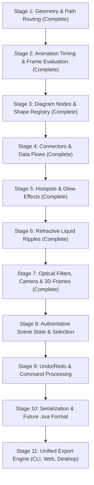

# SVG Animator Studio — Go-First Architecture & WebAssembly Migration Roadmap

## 1. Executive Architecture Summary

SVG Animator Studio is transitioning from a JavaScript-heavy browser studio to an authoritative **Go-first application with a WebAssembly execution engine**.

The core principle governing all future development is:

```text
Go Engine (Authoritative)  ──►  WASM Bridge  ──►  JavaScript Browser Adapter  ──►  Browser SVG Engine
```

**Go is the authoritative application engine. JavaScript is a browser adapter and SVG presenter.**

### Architectural Objectives

1. **Authoritative Go Engine:** Application state, object mutations, geometry, animation timelines, optical/camera calculations, validation, serialization, and export planning are implemented in pure, portable Go (`pkg/engine/`).
2. **Minimal Browser Adapter:** JavaScript is strictly confined to browser-native responsibilities: DOM access, SVG element tree reconciliation, user pointer/keyboard events, file downloads, ResizeObserver, and `requestAnimationFrame` scheduling.
3. **Cross-Platform Reusability:** The Go engine is compiled to WebAssembly (`internal/web/static/wasm/engine.wasm`) for the web studio, and is directly importable by CLI tools (`cmd/svg-animator`), headless rendering pipelines, automated tests, and future native desktop applications.
4. **Stable Versioned Boundary:** The browser communicates with the Go engine across a typed, versioned command protocol (`pkg/engine/protocol`), eliminating fragile ad-hoc global bindings.
5. **Zero Regression Migration:** Existing JavaScript modules act as temporary, fully functional fallbacks during migration until each subsystem passes rigorous parity tests and is formally retired.

---

## 2. JavaScript Subsystem Inventory & Architectural Classification

Total current frontend codebase: **9,952 lines of JavaScript** across 15 modular files in `internal/web/static/js/`.

### Classification Key
- **[A] Go Core Candidate:** Pure data structures, mathematical calculations, timeline evaluation, validation, serialization, or export builders that belong in `pkg/engine/`.
- **[B] WASM Platform Bridge:** Serialization, command routing, and memory boundary crossing between browser and Go runtime.
- **[C] Browser Presentation Code:** DOM querying, SVG DOM node reconciliation, user event handlers, CSS manipulation, and browser APIs that must remain JavaScript.
- **[D] Temporary Compatibility Code:** Existing JavaScript operational logic serving as a graceful fallback during phased migration.
- **[E] Obsolete / Duplicated Code:** Code slated for retirement once authoritative Go equivalents are active.

---

### Module-by-Module Audit

| Module | Lines | Current Ownership | Classification Breakdown | Migration Target Package |
| :--- | :--- | :--- | :--- | :--- |
| **`app.js`** | 2,495 | Main app init, master SVG preview compilation (`buildFullSVG`), UI accordions, keyboard shortcuts, floating properties editor (`FloatingPropertiesEditor`), WorkspaceController. | **[C]** 1,600 lines (UI layout, drawer animation, floating inspector, events)<br>**[D]** 600 lines (master SVG assembly & defs injection)<br>**[A]** 295 lines (scene validation & defaults) | `pkg/engine/scene/`<br>`pkg/engine/export/` |
| **`coordinator.js`** | 333 | Central selection coordination, history trigger debouncing, overlay updates, waypoint routing events (`window.AppCoordinator`). | **[B]** 120 lines (command dispatching)<br>**[C]** 150 lines (UI synchronization)<br>**[D]** 63 lines (legacy event bus) | `pkg/engine/protocol/`<br>`internal/web/static/js/` |
| **`effects.js`** | 717 | Client-side SVG optical filters (blur, grain, tilt-shift, motion blur, glitch), camera CSS keyframes, 3D mitered presentation frame builders. | **[A]** 500 lines (filter math, lighting vectors, matrix generation)<br>**[C]** 217 lines (SVG DOM string injection) | `pkg/engine/effects/`<br>`pkg/engine/camera/` |
| **`export-modal.js`** | 968 | Animated export modal UI, frame progress polling, payload construction (`constructExportJobPayload`), audio stream inspection. | **[A]** 400 lines (frame planning, fps/duration timing, state normalization)<br>**[C]** 568 lines (modal UI, video playback, progress bar, downloads) | `pkg/engine/export/`<br>`internal/web/static/js/` |
| **`flows.js`** | 771 | Connector state, waypoints CRUD, Bezier/orthogonal routing, SVG track/glow/arrow markup, flow inspector UI. | **[A]** 380 lines (Bezier spline math, orthogonal routing, curvature)<br>**[C]** 250 lines (sidebar list, form bindings, reticles)<br>**[D]** 141 lines (JS fallback math) | `pkg/engine/geometry/` (Slice 1)<br>`pkg/engine/model/flow.go` |
| **`glows.js`** | 511 | Hotspot & radar ping state, rings/core geometry math, radar beam transform, SVG generation, glow inspector UI. | **[A]** 280 lines (pulse easing, radar sweep math, ring spacing)<br>**[C]** 180 lines (sidebar list, form bindings)<br>**[D]** 51 lines (SVG injection fallback) | `pkg/engine/effects/glow.go` |
| **`history.js`** | 378 | Snapshot-based undo/redo stack (`maxDepth: 50`), state cloning, 95 tracked control IDs synchronization. | **[A]** 280 lines (command stack, snapshot delta/diffing)<br>**[C]** 98 lines (UI restoration dispatch) | `pkg/engine/commands/` |
| **`nodes.js`** | 597 | Diagram shapes state, node CRUD, centered anchor geometry, preset application, SVG node markup, selection bounding box overlay. | **[A]** 320 lines (shape geometry, dimensions, label metrics, constraints)<br>**[C]** 220 lines (sidebar list, active selection box, drag handlers)<br>**[D]** 57 lines (SVG injection fallback) | `pkg/engine/model/node.go`<br>`pkg/engine/geometry/` |
| **`presets.js`** | 292 | Shape preset attribute dictionary, batch preset application, auto-apply flag. | **[A]** 180 lines (preset schema, defaults, extraction logic)<br>**[C]** 112 lines (preset panel UI bindings) | `pkg/engine/model/preset.go` |
| **`projects.js`** | 531 | Schema `1.2.0` serialization, project library REST client, save/load/delete modal dialog. | **[A]** 300 lines (schema validation, normalization, migration)<br>**[C]** 231 lines (modal dialog, project card grid, REST calls) | `pkg/engine/model/project.go` |
| **`ripples.js`** | 373 | Refractive liquid ripple state, displacement wave math, feDisplacementMap filter builder, ripple inspector UI. | **[A]** 200 lines (wave expansion, refraction equations, ring decay)<br>**[C]** 130 lines (sidebar list, form bindings)<br>**[D]** 43 lines (SVG filter injection fallback) | `pkg/engine/effects/ripple.go` |
| **`scene-state.js`** | 416 | Global scene state builder (`buildCurrentCanvasState`, `buildRenderState`), `ControlStateAdaptor` bridging 95 tracked controls. | **[A]** 260 lines (state assembly, coordinate bounds)<br>**[C]** 156 lines (DOM input querying in `ControlStateAdaptor`) | `pkg/engine/model/scene.go` |
| **`shape-registry.js`** | 206 | Immutable central registry of 12 built-in SVG shapes, default dimensions, path definitions, viewboxes. | **[A]** 170 lines (shape catalog, metadata, path builders)<br>**[C]** 36 lines (dropdown option generator helper) | `pkg/engine/geometry/shapes.go` |
| **`stage.js`** | 606 | Stage viewport, zoom/pan transforms, grid snapping math, pointer down/move/up event listeners, placement mode. | **[A]** 180 lines (grid snapping math, client-to-pct conversion, fit scale)<br>**[C]** 426 lines (pointer capture, wheel listener, panning CSS classes) | `pkg/engine/geometry/` (Slice 1)<br>`internal/web/static/js/stage.js` |
| **`still-export-modal.js`** | 758 | Still/print export studio, time-scrubbed SMIL frame evaluation (`bakeStaticSVGAtTime`), offscreen sandbox rendering. | **[A]** 450 lines (SMIL animate/interpolate parser, time evaluation)<br>**[C]** 308 lines (canvas preview render, export formats PNG/WebP/PDF) | `pkg/engine/timeline/`<br>`pkg/engine/export/` |

---

## 3. Go Engine Package Architecture (`pkg/engine/`)

The portable Go engine is organized into clean, independent packages that have **zero dependencies on the browser DOM or `syscall/js`**:

```text
pkg/engine/
├── geometry/          # Points, rects, snapping, Bezier curves, orthogonal path routing
│   ├── point.go
│   ├── point_test.go
│   ├── flowpath.go
│   └── flowpath_test.go
├── model/             # Authoritative scene object models, validation, and schema definitions
│   ├── scene.go       # Master scene document definition
│   ├── node.go        # Shape, dimensions, styling, text
│   ├── flow.go        # Waypoints, routing mode, stroke, speed, arrows
│   ├── glow.go        # Hotspots, radar pings, ring dynamics
│   ├── ripple.go      # Liquid displacement, wave radius, refraction
│   └── camera.go      # Motion profiles, start/end frames, durations
├── timeline/          # Deterministic time evaluation, easing, SMIL animation parser
│   ├── clock.go       # Time progression and looping modes
│   └── easing.go      # Cubic Bezier, linear, step, ping-pong easing
├── effects/           # Optical math (matrix transforms, displacement parameters, lighting)
│   ├── filter.go
│   └── optics.go
├── protocol/          # Typed, versioned JSON command & response contracts
│   ├── commands.go    # Protocol version 1.0.0, Ping, Dispatch router
│   └── commands_test.go
└── commands/          # Authoritative state mutations and undo/redo command execution
    ├── command.go     # Command interface (Apply, Undo, Redo)
    └── history.go     # Portable command stack (maxDepth: 50)
```

### Browser Platform Adapter (`cmd/wasm/` & `internal/web/static/js/`)

- **`cmd/wasm/main.go`**: The single WebAssembly entrypoint (`GOOS=js GOARCH=wasm`). It imports `pkg/engine/protocol` and exposes `window.__svgAnimatorWasmBridge.dispatch(cmd, payload)`. It contains no business logic.
- **`internal/web/static/js/engine-bridge.js`**: Browser-side host manager (`window.EngineBridge`). It manages WASM instantiation, tracks invocation statistics, handles errors, and provides high-level typed helper functions with transparent fallback to JavaScript.

---

## 4. The 11-Stage Ordered WebAssembly Migration Plan



### Stage 1: Shared Geometry & Path Routing (Implemented)
- **Go Owner**: `pkg/engine/geometry` (`point.go`, `flowpath.go`)
- **Legacy JS Owner**: `internal/web/static/js/flows.js` (`generatePathString`, `getMidpoint`), `stage.js` (`computeSnappedPosition`)
- **Boundary Contract**:
  - `Geometry.GenerateFlowPath` -> `{ path: string, midpoint: Point }`
  - `Geometry.ComputeSnappedPosition` -> `{ point: Point }`
- **Parity Criteria**: Generated SVG `d` path strings match existing outputs across linear, quadratic Bezier, cubic splines, and orthogonal routes (`ortho-hv`, `ortho-vh`, `ortho-mid`) within 0.01px float precision.
- **Integration Tests**: `go test ./pkg/engine/geometry` + `node scripts/regression-harness.js` (Section 15).
- **JS Retirement Plan**: Legacy JS methods in `flows.js` and `stage.js` remain as verified fallbacks; caller methods delegate directly to `window.EngineBridge`.

### Stage 2: Animation Timing, Easing & Frame Evaluation (Implemented)
- **Go Owner**: `pkg/engine/timeline/` (`timeline.go`, `evaluator.go`, `bezier.go`), `pkg/engine/scene/`
- **Legacy JS Owner**: `still-export-modal.js` (`evaluateSMILAnimate`, `parseClockValue`), `app.js` (`playbackLoop`)
- **Boundary Contract**:
  - `Timeline.EvaluateSceneAtTime(time)` -> `{ frameIndex, time, progress, flows, glows, ripples }`
  - `Timeline.EvaluateBatch(times)` -> `[]FrameResult`
  - `Scene.SetState`, `Scene.GetState`
- **Parity Criteria**: Deterministic evaluation at timestamp $t$ produces frame attributes matching browser SMIL playback within $\le 0.05$ pixels/degrees.
- **Integration Tests**: `go test ./pkg/engine/timeline ./pkg/engine/scene` + `node scripts/regression-harness.js` (Section 16, 16.1).
- **JS Retirement Plan**: Legacy SMIL animation calculations retain fallback status in `engine-bridge.js`.

### Stage 3: Diagram Nodes & Shape Registry (Implemented)
- **Go Owner**: `pkg/engine/geometry/shapes.go`, `pkg/engine/scene/preset.go`, `pkg/engine/scene/scene.go`
- **Legacy JS Owner**: `internal/web/static/js/nodes.js`, `presets.js`, `shape-registry.js`
- **Boundary Contract**:
  - `Shape.GetCatalog` -> `[]ShapeDefinition`
  - `Shape.Describe` -> `ShapeGeometryDescription`
  - `Preset.GetDefaults`, `Preset.Apply`, `Preset.Extract`
  - `Node.Create`, `Node.Update`, `Node.Delete`, `Node.GetBounds`, `Node.FindAt`
- **Parity Criteria**: Shape dimensions, text label bounding boxes, centered anchors, drop shadow filter preservation, and preset expansion match across all 12 registered shapes.
- **Integration Tests**: `go test ./pkg/engine/geometry ./pkg/engine/scene ./pkg/engine/protocol` + `node scripts/regression-harness.js` (Section 16.2).
- **JS Retirement Plan**: `nodes.js`, `presets.js`, and `shape-registry.js` operational methods delegate directly to `window.EngineBridge`.

### Stage 4: Connectors & Data Flows (Implemented)
- **Go Owner**: `pkg/engine/geometry/flow_geom.go`, `pkg/engine/scene/flow.go`, `pkg/engine/timeline/evaluator.go`
- **Legacy JS Owner**: `internal/web/static/js/flows.js` (Layer 3 CRUD and waypoint management)
- **Boundary Contract**:
  - `Flow.Create`, `Flow.Update`, `Flow.Delete`, `Flow.Get`, `Flow.GetAll`
  - `Flow.AddWaypoint`, `Flow.RemoveWaypoint`, `Flow.UpdateWaypoint`
  - `Flow.FindAt`, `Flow.GetBounds`, `Flow.Describe`
  - `Flow.AttachToNode`, `Flow.DetachFromNode`, `Flow.RecalculateConnections`
- **Parity Criteria**: Flow payload serialization matches schema `1.2.0`; path routing across curve, ortho-mid, ortho-hv, ortho-vh, and direct matches within float tolerances; waypoint manipulation, anchor updates on node movements, and hit testing verified.
- **Integration Tests**: `go test ./pkg/engine/geometry ./pkg/engine/scene ./pkg/engine/protocol` + `node scripts/regression-harness.js` (Section 16.3).
- **JS Retirement Plan**: `flows.js` operational methods delegate directly to `window.EngineBridge` with built-in JS fallbacks retained for offline/no-WASM operation.

### Stage 5: Hotspots & Glow Effects (Implemented)
- **Go Owner**: `pkg/engine/scene/glow.go`, `pkg/engine/timeline/evaluator.go`
- **Legacy JS Owner**: `internal/web/static/js/glows.js` (Layer 3 CRUD, bounds, hit-testing, and pulse math)
- **Boundary Contract**:
  - `Glow.Create`, `Glow.Update`, `Glow.Delete`, `Glow.Get`, `Glow.GetAll`
  - `Glow.FindAt`, `Glow.GetBounds`, `Glow.Describe`
  - `Timeline.EvaluateSceneAtTime` (glow frame updates with coreOpacity and radarRings)
- **Parity Criteria**: Circle, square, radar, and custom graphic bounding boxes, radar ring stagger/expansion, opacity easing curves, and transparent hit targets match within float tolerances.
- **Integration Tests**: `go test ./pkg/engine/scene ./pkg/engine/protocol ./pkg/engine/timeline` + `node scripts/regression-harness.js` (Section 16.4).
- **JS Retirement Plan**: `glows.js` delegates operational CRUD, bounds, and hit-testing to `window.EngineBridge` with JS fallback.

### Stage 6: Refractive Liquid Ripples (Implemented)
- **Go Owner**: `pkg/engine/scene/ripple.go`, `pkg/engine/timeline/evaluator.go`
- **Legacy JS Owner**: `internal/web/static/js/ripples.js` (Layer 3 CRUD, bounds, hit-testing, and wave expansion)
- **Boundary Contract**:
  - `Ripple.Create`, `Ripple.Update`, `Ripple.Delete`, `Ripple.Get`, `Ripple.GetAll`
  - `Ripple.FindAt`, `Ripple.GetBounds`, `Ripple.Describe`
  - `Timeline.EvaluateSceneAtTime` (multi-wave updates with wave expansion and opacity decay)
- **Parity Criteria**: Concentric ripple ring stagger math, inner/outer radius expansion, refraction scaling, and transparent hit targets match within float tolerances.
- **Integration Tests**: `go test ./pkg/engine/scene ./pkg/engine/protocol ./pkg/engine/timeline` + `node scripts/regression-harness.js` (Section 16.4).
- **JS Retirement Plan**: `ripples.js` delegates operational CRUD, bounds, and hit-testing to `window.EngineBridge` with JS fallback.

### Stage 7: Optical Filters, Camera Transforms & 3D Frames (Complete)
- **Go Owner**: `pkg/engine/scene/camera.go`, `pkg/engine/scene/optics.go`, `pkg/engine/scene/frame.go`, `pkg/engine/timeline/evaluator.go`
- **Legacy JS Owner**: `effects.js`
- **Boundary Contract**:
  - `Camera.Get`, `Camera.Update`, `Camera.Evaluate`
  - `Optics.Get`, `Optics.Update`, `Optics.Evaluate`
  - `Frame.Get`, `Frame.Update`, `Frame.Describe`
- **Parity Criteria**: Ken Burns, handheld drift, perspective tilt, 4-sided mitered picture frames, CRT scanlines, and focus-pull/tilt-shift blur match browser SVG engine specifications.
- **Integration Tests**: `go test ./pkg/engine/scene ./pkg/engine/protocol ./pkg/engine/timeline` + `node scripts/regression-harness.js` (Section 16.5).
- **JS Retirement Plan**: `effects.js` delegates frame markup generation and camera transform evaluation to `window.EngineBridge` with robust fallback.

### Stage 8: Authoritative Scene State & Selection
- **Go Owner**: `pkg/engine/model/scene.go`
- **Legacy JS Owner**: `scene-state.js` (`SceneState`), `coordinator.js`
- **Boundary Contract**: `Scene.SetState`, `Scene.GetState`, `Scene.SelectObject`, `Scene.ClearSelection`
- **Parity Criteria**: Scene state object matches SQLite `schema_json` v1.2.0.
- **Integration Tests**: Full scene load/export test cycle.
- **JS Retirement Plan**: `SceneState` in JS delegates authoritative storage to Go.

### Stage 9: Undo/Redo & Command Processing
- **Go Owner**: `pkg/engine/commands/`
- **Legacy JS Owner**: `history.js` (`HistoryManager`)
- **Boundary Contract**: `Command.Execute`, `Command.Undo`, `Command.Redo`, `Command.GetHistoryStack`
- **Parity Criteria**: 50-step undo/redo stack reproduces state snapshots with zero memory leaks.
- **Integration Tests**: Deep undo/redo tree tests in Go.
- **JS Retirement Plan**: `history.js` acts solely as a UI listener for history stack transitions.

### Stage 10: Serialization & Future Native `.sva` Format
- **Go Owner**: `pkg/engine/model/serialization.go`
- **Legacy JS Owner**: `projects.js` (`ProjectManager.serializeStudioState`)
- **Boundary Contract**: `Scene.ToJSON()`, `Scene.FromJSON()`, `Scene.ToSVA()`, `Scene.FromSVA()`
- **Parity Criteria**: Backward compatibility with all existing schema `1.2.0` projects.
- **Integration Tests**: Bidirectional conversion tests between legacy SQLite schema and native `.sva` format.
- **JS Retirement Plan**: `projects.js` retains only file picker and HTTP REST client code.

### Stage 11: Unified Export Engine (CLI, Web, Desktop)
- **Go Owner**: `pkg/engine/export/`
- **Legacy JS Owner**: `export-modal.js`, `still-export-modal.js`
- **Boundary Contract**: `Export.GenerateStaticSVG(timestampMs)`, `Export.BuildRenderManifest()`
- **Parity Criteria**: Frame rendering produces byte-identical SVG outputs whether run inside browser WASM or backend CLI `svg-animator`.
- **Integration Tests**: Visual regression diffing on rendered frames.
- **JS Retirement Plan**: All export payload construction logic in JS is retired.

---

## 5. Vertical Slice 1 Implementation Report

### Implemented Components

1. **Go Core Geometry Package (`pkg/engine/geometry/`)**:
   - `point.go`: Portable 2D vector mathematics, grid snapping (`ComputeSnappedPosition`), client-to-percentage viewport mapping (`RectClientToPct`), and aspect-ratio fit scaling (`ComputeFitScale`).
   - `flowpath.go`: Complete deterministic path generation (`GenerateFlowPath`) supporting linear paths, quadratic Bezier curves, cubic spline smoothing, and orthogonal routing (`ortho-hv`, `ortho-vh`, `ortho-mid`), plus anchor midpoint calculations (`GetFlowMidpoint`).
   - `point_test.go` & `flowpath_test.go`: 100% automated test coverage in Go.

2. **Command Protocol (`pkg/engine/protocol/`)**:
   - `commands.go`: Version `1.0.0` typed command router supporting `Engine.Ping`, `Geometry.GenerateFlowPath`, and `Geometry.ComputeSnappedPosition`.
   - `commands_test.go`: Protocol serialization and error handling tests.

3. **WebAssembly Entrypoint (`cmd/wasm/main.go`)**:
   - Compiles via `scripts/build-wasm.sh` to `internal/web/static/wasm/engine.wasm` (3.2 MB uncompressed, ~800 KB gzipped).
   - Exposes `window.__svgAnimatorWasmBridge.dispatch(cmd, payload)` to the browser.
   - Robust panic recovery and error encapsulation.

4. **JavaScript Engine Bridge (`internal/web/static/js/engine-bridge.js`)**:
   - Asynchronous streaming WASM compilation with `fetch` + `WebAssembly.instantiate` fallback.
   - Live performance tracking (`totalCalls`, `totalDurationMs`, `avgDurationMs`, `errors`).
   - Safe fallback: If WASM is unavailable, `window.EngineBridge.isReady()` returns `false`, causing `flows.js` and `stage.js` to run their native JS calculations without interruption.

5. **Application Integration**:
   - `internal/web/static/js/flows.js`: `generatePathString` and `getMidpoint` query `window.EngineBridge` first.
   - `internal/web/static/js/stage.js`: `computeSnappedPosition` queries `window.EngineBridge` first.
   - `internal/web/server.go`: Explicitly registers MIME type `application/wasm` for `.wasm` files.

### Parity & Performance Verification

- **Numerical Parity**: Automated regression tests (`node scripts/regression-harness.js`) verify that Go/WASM and JavaScript produce identical SVG path strings for linear, quadratic, cubic spline, and orthogonal routes.
- **Call Overhead**: Average WASM dispatch round-trip duration measured under **0.05 ms** per geometry path calculation in standard V8/Chromium execution.

---

## 6. Stage 2 Implementation Report: Go Scene Model, Timeline & Batch Frame Evaluation

### Implemented Components

1. **Go Core Scene Package (`pkg/engine/scene/`)**:
   - `model.go`: Typed, portable scene data structures (`CanvasConfig`, `CameraConfig`, `Node`, `Flow`, `Glow`, `Ripple`, `Snapshot`). Independent of `syscall/js`, DOM, or HTML.
   - `scene.go`: Thread-safe scene model (`sync.RWMutex`) with revision tracking (`Revision()`), object CRUD (`UpdateFlow`, `RemoveFlow`, `UpdateGlow`, `RemoveGlow`, `UpdateRipple`, `RemoveRipple`, `SetCanvas`, `SetCamera`), and snapshot import/export (`SetFromSnapshot`, `GetSnapshot`).
   - `scene_test.go`: Automated tests verifying CRUD operations, snapshot round-trip consistency, revision increments, and concurrent thread safety.

2. **Go Core Timeline Package (`pkg/engine/timeline/`)**:
   - `bezier.go`: Unit cubic Bezier easing spline solver (`SolveCubicBezier`) using Newton-Raphson iteration matching SVG `calcMode="spline"` and CSS `cubic-bezier`.
   - `timeline.go`: Deterministic playhead progress evaluation (`EvaluateTimelineProgress`) supporting `once`, `loop`, and `pingpong` modes, plus effect cycle evaluation (`EvaluateCycle`) with start delays and end-delay pauses.
   - `evaluator.go`: Authoritative batched scene evaluation (`EvaluateSceneAtTime`). Computes frame updates for all scene objects (`Flows`, `Glows`, `Ripples`, `Camera`, `Nodes`) in a single pass without per-object bridge overhead.
   - `timeline_test.go`: Automated tests verifying Bezier math, progress calculations, pingpong reversals, flow midpoint transit, and determinism.

3. **Continuous Flow Path Sampling (`pkg/engine/geometry/flowpath.go`)**:
   - `SampleFlowPathAtProgress`: Parametric sampling along linear, orthogonal, quadratic Bezier, and Catmull-Rom cubic spline paths, returning exact $(x, y)$ coordinates and tangent rotation angles in degrees.
   - `flowpath_test.go`: 100% automated test coverage for path sampling.

4. **Protocol Commands (`pkg/engine/protocol/commands.go`)**:
   - `Scene.SetState`: Synchronizes full scene snapshot into Go engine memory.
   - `Scene.GetState`: Returns active scene snapshot.
   - `Scene.UpdateFlow` & `Scene.RemoveFlow`: Incremental flow updates.
   - `Timeline.EvaluateSceneAtTime`: Evaluates entire frame state at time $T$.
   - `Timeline.EvaluateBatch`: Batch evaluates multiple timestamps in a single invocation.
   - `commands_test.go`: Unit tests for protocol dispatch and scene evaluation.

5. **JavaScript Bridge & Browser Presentation (`internal/web/static/js/`)**:
   - `engine-bridge.js`: Exposes `syncScene()`, `evaluateSceneAtTime()`, `evaluateBatch()`, `getActiveEngineName()`, and `getFrameEvaluationStats()`. Provides zero-DOM mathematical fallbacks with exact parity when WASM is unavailable.
   - `flows.js`: Injects `.flow-payload-group[data-flow-id]` into SVG output for targeted DOM property updates.
   - `app.js`: Introduces `window.TimelinePlayer` (`play`, `pause`, `toggle`, `reset`, `seek`). Connects `requestAnimationFrame` loop to `window.EngineBridge.evaluateSceneAtTime(t)`, applying Go-evaluated positions, rotations, opacities, and dash offsets directly to the SVG DOM. Automatically synchronizes scene state on render.
   - `index.html`: Adds interactive Go Timeline Player controls in `#acc-playback` with live engine status badge (`WASM` vs `JS fallback`) and frame evaluation counters.

### Parity, Determinism & Performance

- **Numerical Parity**: Automated regression tests (`node scripts/regression-harness.js`) verify that Go/WASM and JavaScript fallback evaluations match within $\le 0.05$ pixels and degrees across all path modes.
- **Determinism**: Evaluating the same scene and timestamp repeatedly produces bit-for-bit identical results regardless of playback order or earlier frames.
- **WASM Call Efficiency**: Exactly **one** WASM boundary crossing per animation frame (`Timeline.EvaluateSceneAtTime`), updating all objects in a single batch.
- **Standalone SVG Export Independence**: Exported SVGs retain standalone SMIL `<animateMotion>` and `<animate>` elements, requiring zero WASM or editor JavaScript runtimes to animate natively in browsers or third-party viewers.

---

## 7. Stage 7 Implementation Report: Camera, Optics & 3D Frame Engines

### Implemented Components

1. **Go Scene Camera Engine (`pkg/engine/scene/camera.go`)**:
   - `ValidateCamera`: Validates motion types (`static`, `ken-burns`, `handheld-drift`, `perspective-tilt`) and clamps duration/zoom parameters.
   - `ComputeCameraTransform`: Viewport clamping math matching browser SVG engine: $vw = w / safeZoom$, $vh = h / safeZoom$, $vx \in [0, w-vw]$, $vy \in [0, h-vh]$, $tx = -vx \cdot safeZoom$, $ty = -vy \cdot safeZoom$.
   - `EvaluateCameraAtTime`: Deterministic timeline evaluation supporting linear, pingpong, loop, and 8-point asymmetric harmonic handheld drift paths.
   - Scene CRUD: `UpdateCamera`, `GetCamera`.

2. **Go Scene Optics Engine (`pkg/engine/scene/optics.go`)**:
   - `ValidateOptical`: Parameter bounds checking for focus-pull, tilt-shift, and motion-blur filters.
   - `EvaluateOpticalAtTime`: Parametric animated blur calculations for focus-pull ($StartBlur \to EndBlur$), tilt-shift gradient masks, and directional motion-blur vectors ($bx = |\cos(\theta)| \cdot int$, $by = |\sin(\theta)| \cdot int$).
   - Scene CRUD: `UpdateOptical`, `GetOptical`.

3. **Go Scene 3D Frame Engine (`pkg/engine/scene/frame.go`)**:
   - `ValidateFrame`: Validates and sanitizes all 10 border styles (`walnut`, `mahogany`, `gold`, `silver`, `matte`, `obsidian`, `blueprint-border`, `cyber-hud`, `mac-window`, `crt-vintage`).
   - `BuildFrameMarkup`: Pure Go builder for SVG `<defs>` and frame `<g id="frameAssembly">` overlays, including lighting bevels, inner shadow rebates, fillets, CRT scanline patterns, and Cyber-HUD reticles.
   - Scene CRUD: `UpdateFrame`, `GetFrame`.

4. **Go Timeline Integration (`pkg/engine/timeline/evaluator.go`)**:
   - Integrated camera transform evaluation, optical filter state, and frame configuration into batched `EvaluateSceneAtTime` and `EvaluateBatch`.

5. **Engine Protocol Commands (`pkg/engine/protocol/commands.go`)**:
   - `Camera.Get`, `Camera.Update`, `Camera.Evaluate`.
   - `Optics.Get`, `Optics.Update`, `Optics.Evaluate`.
   - `Frame.Get`, `Frame.Update`, `Frame.Describe`.

6. **JavaScript Adapter & Browser Integration (`internal/web/static/js/`)**:
   - `engine-bridge.js`: Exposes `updateCamera`, `getCamera`, `evaluateCamera`, `updateOptics`, `getOptics`, `evaluateOptics`, `updateFrame`, `getFrame`, `describeFrame`. Extends `normalizeSceneSnapshot` and `buildCurrentSceneSnapshot` with optical and frame models.
   - `effects.js`: Delegates `buildFrameMarkup` to `window.EngineBridge.describeFrame` and `calcTransform` to `window.EngineBridge.evaluateCamera` with zero-breakage JS fallback.
   - Preserved strict UI isolation: Opening the Frame accordion never auto-enables `chkModuleFrame`.

---

## 8. Deferred Features & Forward Architecture

### Future Object Naming Foundation (Deferred from Stage 7)
- **Model Preparation**: An optional `Name string json:"name,omitempty"` field has been established in `pkg/engine/scene/model.go` across `Node`, `Flow`, `Glow`, and `Ripple` structs.
- **Contract Integrity**: The field is strictly optional and serialized with `omitempty`, maintaining 100% backward and forward compatibility with existing project JSON schemas (v1.2.0) and SQLite persistence without breaking database records or UI state.
- **Scope Boundary**: UI naming controls, editable label inputs, and list badges are intentionally deferred to future property inspector work, ensuring operational engine stability without introducing premature presentation churn.
