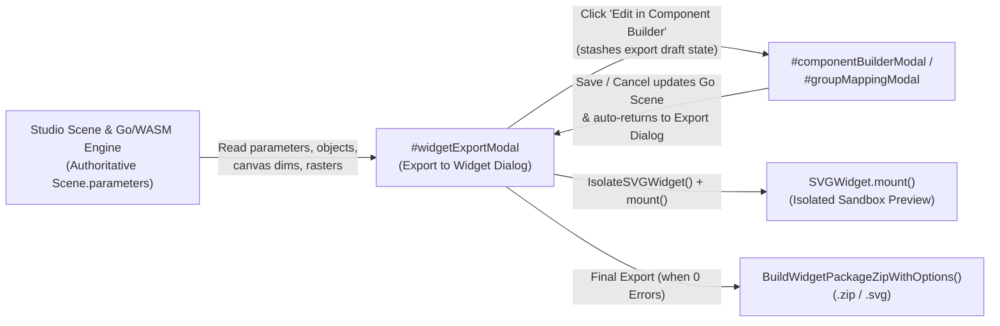

# Stage 16F — Dedicated Export to Widget Dialog Architecture & Implementation Plan

**Project:** SVG Animator Studio  
**Programme:** Stage 16F Usability & Export-Workflow Refinement  
**Document:** `docs/stage16f-export-widget-dialog-plan.md`  
**Status:** **PROPOSED — AWAITING USER REVIEW**  
**Scope:** Dedicated `#widgetExportModal` pre-flight review, event-trigger & reverse-state auditing, live `SVGWidget.mount()` sandbox preview, simplified canonical package structure, and seamless round-trip navigation with Component Builder

---

## 1. Executive Summary & Objective

As SVG Animator Studio's Widget Maker has matured across Stages 16C, 16E, and 16F, exported widgets now combine:
- Component-level multi-action properties (`When TRUE` / `When FALSE` / per-enum state branches) targeting unrelated objects without grouping (`#componentBuilderModal`).
- Domestic browser event triggers (`hover`, `press`, `click`, `focus`, `dblclick`).
- Reusable content properties (`Label` bound to `text-lite.text` and `Icon` bound to `image.src`).
- Group semantic property mappings (`#groupMappingModal`), single-object properties, and whole-widget controls (`playbackRate`, `visibility`, `operatingState`).
- Non-destructive export-time raster image downsampling (`1×`, `2×`, `3×`, `Original`).

Currently, clicking **Export Reusable SVG Widget** or **Export Widget Package (ZIP)** in the right-hand `#acc-export` drawer immediately downloads a file without giving the author a single place to review exposed properties, audit browser event triggers, spot missing `FALSE`-state restoration actions, test the isolated widget in the real `SVGWidget.mount()` runtime, or verify export settings.

This plan specifies a dedicated, spacious **Export to Widget** dialog (`#widgetExportModal`) that brings pre-flight review, validation, live interaction testing, and export configuration together in one coherent workflow—**without** redesigning Component Builder or replacing `svg-widget.js`.

---

## 2. Current Export Workflow Assessment

An inspection of the current codebase (`commit f867e1d`) identified seven concrete workflow and usability issues that surfaced during real-world testing of [`demos/Stage-16F-Widget-Export/fleet1.svg`](../demos/Stage-16F-Widget-Export/fleet1.svg) in Sentinel-PVE:

### 2.1 Authoring and Export Are Split Across Separate Drawers With No Pre-Flight Review
- **Current Implementation:**
  - Property authoring lives in `#acc-widget-params` ([`index.html:4030-4119`](../internal/web/static/index.html#L4030-L4119)), split across `#componentBuilderSection`, `#drawerWidgetAuthoringDeck`, Whole Widget Controls, and `#widgetParamsList`.
  - Export buttons (`#btnDownloadWidgetSVG`, `#btnDownloadWidgetGuide`, `#btnDownloadWidgetPackage`) live in `#acc-export` ([`index.html:4122-4150`](../internal/web/static/index.html#L4122-L4150)) and immediately trigger browser downloads ([`app.js:6554-6685`](../internal/web/static/js/app.js#L6554-L6685)).
- **Consequence:** The author cannot review the complete component contract in one place before generating the package.

### 2.2 Invisible Event-Trigger Configuration & Removal of Name-Based Implicit Guessing
- **Current Implementation:**
  - In the uploaded [`fleet1.svg`](../demos/Stage-16F-Widget-Export/fleet1.svg), the author created `Selected`, `OnClick`, and `MouseOver`, but `"eventTrigger": "hover"` was missing from `MouseOver` in the exported manifest because `#widgetParamsList` did not prominently summarise event triggers vs host-only parameters before export.
  - During the initial `fleet1.svg` review (`74a51ac`), a convention fallback was added in [`svg-widget.js:3819`](../internal/web/static/js/svg-widget.js#L3819) (`if (!trig && String(p.name).toLowerCase() === 'mouseover') trig = 'hover'`) and [`component-builder.js:244`](../internal/web/static/js/component-builder.js#L244) (auto-selecting `hover`/`press`/`click` based on typed property names).
- **Required Correction:**
  - **Never automatically assign `Hover`, `Press`, or `Click` based solely on a property's name.** A consuming application (such as Digital Twin or Sentinel-PVE) may intentionally expose a property named `MouseOver` or `Selected` that it wants to drive purely via `setParameter()` without domestic DOM listeners interfering.
  - Both `svg-widget.js` and `component-builder.js` must require explicit author selection of `eventTrigger` (defaulting to `None`), and the new **Export to Widget** dialog must display an explicit **Event Trigger Review** table so missing or unintended triggers are obvious before export.

### 2.3 No Warning When Multiple Properties Share the Same Browser Event
- **Current Implementation:** Multiple Boolean properties can be configured with `eventTrigger: "hover"` or `eventTrigger: "press"` with zero visibility or warning.
- **Required Enhancement:** Display a clear, non-blocking warning in the Export to Widget dialog whenever two or more properties are bound to the same browser event trigger.

### 2.4 No Detection of Missing Reverse-State (`When FALSE`) Actions
- **Current Implementation:**
  - In [`fleet1.svg`](../demos/Stage-16F-Widget-Export/fleet1.svg), `OnClick` defines 4 `When TRUE` actions (`lite-1.color = #0f172a`, `lite-1.bgColor = #95892d`, `lite-1.borderColor = #0f172a`, `lite-1.play = stop_reset`) and 3 `When FALSE` actions (`lite-1.color = #95892d`, `lite-1.borderColor = #95892d`, `lite-1.bgColor = #03152e` — notice `bgColor` restores `#03152e` instead of authored `#0f172a`, and `play` is not restored).
  - More generally, if an author creates a Boolean property (especially one bound to a transient event like `Press` or `Hover`) with `When TRUE` actions but forgets to configure `When FALSE` actions (or starts an animation in `TRUE` with no stop/reset in `FALSE`), the widget stays visually stuck in its active state after the event ends.
- **Required Enhancement:** Add a non-blocking **Missing Reverse-State Action** detector that warns when a Boolean property has `TRUE` actions without corresponding `FALSE` restoration actions (without automatically inventing `FALSE` actions or blocking deliberate one-way effects).

### 2.5 Raw Internal Object IDs Instead of Human-Readable Action Summaries
- **Current Implementation:** `#widgetParamsList` ([`app.js:5306`](../internal/web/static/js/app.js#L5306)) displays `Target: root → [lite-1.borderColor, lite-1.color, lite-3.play]`.
- **Required Enhancement:** Resolve internal target IDs (`lite-1`, `lite-3`, `lite-4`, `image-image-1`, `node-1`) to their authored object names/labels and render separate, plain-English **`When TRUE`** and **`When FALSE`** bullet summaries.

### 2.6 No Isolated `SVGWidget.mount()` Preview Before Export
- **Current Implementation:** The inline `Preview:` controls in `#widgetParamsList` ([`app.js:5337-5419`](../internal/web/static/js/app.js#L5337-L5419)) directly mutate the live Studio canvas `#svgContainer` DOM rather than running the isolated SVG through `SVGWidget.mount()`.
- **Required Enhancement:** Mount the actual isolated SVG inside a dedicated sandbox container in the Export to Widget dialog using `SVGWidget.mount()`, complete with live hover/press/click testing, parameter controls, reset-to-defaults, and full `destroy()` cleanup on close.

### 2.7 Duplicated Convenience Files in `<base>.zip`
- **Current Implementation:** Commit `f867e1d` added `<base>.json`, `<base>.html`, `<base>.md`, and `js/<base>.js` alongside `widget-manifest.json`, `demo.html`, `<base>-properties.md`, `README.md`, and `js/svg-widget.js` (11 files total in the ZIP).
- **Required Refinement:** Simplify the ZIP back to the clean, non-duplicated **7-file canonical Stage 16C/16F package structure** where the archive (`<base>.zip`), primary SVG (`<base>/<base>.svg`), and properties guide (`<base>/<base>-properties.md`) use the base name, while preserving `widget-manifest.json`, `js/svg-widget.js`, `demo.html`, `README.md`, and `preview.svg` as single canonical files with zero redundant duplicates.

---

## 3. Proposed Dedicated Dialog Layout (`#widgetExportModal`)

Selecting **📦 Export to Widget...** (available in both the **🚀 Export & Render Studio** drawer and the **🌐 Widget Maker** drawer header) opens `#widgetExportModal` (`1040px` wide, `max-height: 90vh`, dark studio theme matching `#exportModal` and `#componentBuilderModal`).

```
+--------------------------------------------------------------------------------------------------+
| 📦 Export to Widget — Review, Validate & Package                                           [ × ] |
| Review exposed properties, browser event triggers, conditional actions, and live runtime preview |
+--------------------------------------------------------------------------------------------------+
| [ 1. Widget Details & Export ] [ 2. Properties & Events (5) ] [ 3. Live Preview ] [ 4. Package ] |
|                                                                   Status: ✅ 0 Errors • ⚠️ 1 Warn |
+--------------------------------------------------------------------------------------------------+
|                                                                                                  |
|  (Active Tab Viewport — Spacious two-column or full-width cards without nested modals)           |
|                                                                                                  |
+--------------------------------------------------------------------------------------------------+
| ✅ Ready to Export (5 properties • 200×50 px • 2× HiDPI Raster Policy)                           |
| [ Cancel ]                            [ 📄 Export Standalone SVG ]  [ 🎁 Export Widget (.zip) ]  |
+--------------------------------------------------------------------------------------------------+
```

### 3.1 Tab 1 — `1. Widget Details & Export Settings`

Organized as a clean two-column layout:

1. **Left Column — Widget Identity & Metadata:**
   - **Widget Display Name** (`#wxWidgetTitleInput`): Human-readable title (e.g. `Fleet Sanctum Button`), pre-populated from `#projectNameInput` or active composite metadata.
   - **Export Base Name** (`#wxBaseNameInput`): Single slug input (e.g. `fleet`). Entering `fleet` once automatically updates the live read-only filename preview badge:
     - Archive: `fleet.zip`
     - Primary SVG: `fleet/fleet.svg` (Root ID: `sva-widget-fleet`, prefix: `fleet__`)
     - Properties Guide: `fleet/fleet-properties.md`
     - Manifest & Runtime: `fleet/widget-manifest.json`, `fleet/js/svg-widget.js`
   - **Description** (`#wxDescriptionInput`): Optional summary embedded in `widget-manifest.json` and `README.md`.
   - **Category, Version & Tags** (`#wxCategorySelect`, `#wxVersionInput`, `#wxTagsInput`): Existing Stage 16E/16F `WidgetManifest` metadata fields (`general`, `controls`, `meters`, `indicators`, `panels`, etc.; SemVer default `1.0.0`).
   - **Canvas & Artwork Summary Card (Read-Only):**
     - Displays current canvas dimensions (`200 × 50 px`), object inventory (`3 Low-Load Effects, 1 Image`), and fixed vs externally configurable content summary.

2. **Right Column — Export Configuration & Raster Image Optimisation:**
   - **Embedded Raster-Image Optimisation Policy (`#wxRasterPolicyCards`):**
     Four selectable radio cards with plain-English explanations (nodestructive changes to Studio project images):
     - **`2× — Recommended` (`value="2x"`, Default):**
       *Embedded images are sized for approximately twice their displayed dimensions, providing a reasonable balance between sharpness on high-DPI displays and compact file size.*
     - **`1× — Displayed Size` (`value="1x"`):**
       *Embedded images are sized to match their exact displayed dimensions on the widget canvas for the smallest possible file size.*
     - **`3× — High Magnification` (`value="3x"`):**
       *Embedded images are sized for up to three times their displayed dimensions. Smaller source images are never upscaled.*
     - **`Original — Unmodified Resolution` (`value="original"`):**
       *Preserves the full original pixel resolution of imported images while removing duplicate attribute data.*
   - **Scene Raster Inventory Note:** Lists any embedded raster images detected in the scene (e.g., `FleetOwlBook: 572 × 572 px source displayed at 49 × 49 px → 98 × 98 px at 2× policy`).

---

### 3.2 Tab 2 — `2. Properties, Events & Conditional Actions`

Brings together all exposed properties and event bindings in three structured panels:

#### Panel A — Reusable Content vs Fixed Artwork Audit
- Summarises all `Text Box Lite`, `Shape` text, and `Image` objects on the canvas so the designer immediately sees which content is externally configurable and which is fixed in the artwork:
  - `Text Box Lite #1 ("Fleet Sanctum")` → **Externally Configurable via `Label` (`text`)** *(or **Fixed in Artwork** with a `[+ Expose Label in Component Builder]` button if not yet exposed)*.
  - `Image #1 ("FleetOwlBook")` → **Externally Configurable via `Icon` (`text` / `image.src`)** *(or **Fixed in Artwork** with a `[+ Expose Icon in Component Builder]` button if not yet exposed)*.
- Never automatically exposes text or image properties without user action.

#### Panel B — Browser Event Trigger Review Table
A dedicated audit table showing every exposed property, how it is controlled, and whether any browser event is bound:

| Exposed Property | Type | Default | Browser Event Trigger | Control Mode |
| :--- | :--- | :--- | :--- | :--- |
| **`MouseOver`** | `boolean` | `false` | **Hover** (`mouseenter` / `mouseleave`) | Browser Event + Consuming App (`Both`) |
| **`OnClick`** | `boolean` | `false` | **Press** (`pointerdown` / `pointerup`) | Browser Event + Consuming App (`Both`) |
| **`Selected`** | `boolean` | `false` | **None** | Consuming Application Only (`setParameter`) |
| **`Label`** | `text` | `"Fleet Sanctum"` | **None** | Consuming Application Only (`setParameter`) |
| **`Icon`** | `text` | `""` *(Authored Image)* | **None** | Consuming Application Only (`setParameter`) |

- **Duplicate Event Binding Warning Banner:** If two or more properties share the same `eventTrigger` (e.g. two properties bound to `Hover`), an amber warning banner appears directly below the table:
  > ⚠️ **Shared Browser Event Trigger:** `MouseOver` and `HoverGlow` are both bound to **Hover**. Both properties will be triggered together when the pointer enters or leaves the widget.
- **Unassigned Event-Like Name Notice (Non-Blocking Info):** If a Boolean property is named `MouseOver`, `OnHover`, `OnClick`, or `Pressed` but its `Browser Event Trigger` is set to `None`, the row displays an informational badge (`ℹ️ Controlled externally only — edit in Component Builder if you want automatic Hover/Press events`) so the original `fleet1.svg` oversight is caught immediately without silently guessing or mutating the property.

#### Panel C — Property Cards & Human-Readable Conditional Action Summaries
Each exposed property is rendered as a readable card showing:
- **Header:** Property Name (`MouseOver`), Label (`Mouse Over State`), Type badge (`BOOLEAN`), Default value (`false`), Event Trigger badge (`Hover`), binding count (`4 actions`), and an **`[ ✏️ Edit in Component Builder ]`** button.
- **Readable Conditional Action Summary (No Raw Internal IDs):**
  Internal target keys (`lite-1`, `lite-3`, `lite-4`, `image-image-1`) are resolved via a helper `describeTargetObject(targetKey)` to `"<Object Name>" (<Kind Label>)`:
  - **`MouseOver = TRUE`**
    - `Radar Ping #4` visibility: **On** (`true`)
    - `Radar Ping #4` animation: **Play**
  - **`MouseOver = FALSE`**
    - `Radar Ping #4` animation: **Stop and Reset**
    - `Radar Ping #4` visibility: **Off** (`false`)
  - **`Selected = TRUE`**
    - `Text Box "Fleet Sanctum"` border colour: **`#95892d`** (colour swatch)
    - `Text Box "Fleet Sanctum"` text colour: **`#95892d`** (colour swatch)
    - `Text Box "Fleet Sanctum"` box background colour: **`#03152e`** (colour swatch)
    - `Text Box "Fleet Sanctum"` animation: **Play**
    - `Perimeter Tracer #3` colour: **`#95892d`** (colour swatch)
    - `Perimeter Tracer #3` visibility: **On** (`true`)
    - `Perimeter Tracer #3` animation: **Play**
  - **`Selected = FALSE`**
    - `Text Box "Fleet Sanctum"` text colour: **`#95892d`** (colour swatch)
    - `Text Box "Fleet Sanctum"` box background colour: **`#0f172a`** (colour swatch)
    - `Text Box "Fleet Sanctum"` border colour: **`#95892d`** (colour swatch)
    - `Text Box "Fleet Sanctum"` animation: **Stop and Reset**
    - `Perimeter Tracer #3` visibility: **Off** (`false`)
    - `Perimeter Tracer #3` animation: **Stop and Reset**
- **Missing Reverse-State (`FALSE`) Warning on Card:**
  If a Boolean property has `TRUE` actions that modify visual properties or start an animation without corresponding `FALSE` restoration actions, an amber warning callout is shown inside the card with a 1-click **`[ ✏️ Fix in Component Builder ]`** button.

---

### 3.3 Tab 3 — `3. Live Sandbox Preview & Interaction Test`

Provides an authentic pre-export test bench powered by `window.SVGWidget.mount()`:

- **Left / Center Stage — Mounted Isolated Widget (`#wxPreviewStage`):**
  - Isolates the current SVG using the selected Export Base Name and Raster Policy, and mounts it via `SVGWidget.mount(previewContainer, isolatedSvg, { instanceId: cleanBase + '-preview' })`.
  - **Comparison Mode Toggle (`Single Instance` | `2 Reusable Instances Side-by-Side`):**
    - In **2 Reusable Instances** mode, mounts Instance A and Instance B side-by-side so the author can enter different `Label` or `Icon` values (e.g. `Fleet Sanctum` vs `Storage`) and verify multi-instance CSS/animation independence before exporting.
  - **Live Event Activity Pill (`#wxPreviewEventLog`):** Displays domestic browser events (`mouseenter → MouseOver = true`, `pointerdown → OnClick = true`, `pointerup → OnClick = false`) as the user interacts with the preview stage.
- **Right Deck — Interactive Parameter Controls (`#wxPreviewControlsDeck`):**
  - Renders live controls for every exposed parameter (`boolean` toggle buttons, `number`/`speed` sliders, `color` pickers, `enum` selectors, `text` inputs).
  - **`[ ↺ Reset Preview to Defaults ]`** button calls `previewInstance.resetParameters()` and re-syncs all controls.
  - **Strict Isolation From Studio Project:** Interacting with the preview never modifies `window.LiteEffects`, `window.DiagramNodes`, `window.ImageObjects`, or `HistoryManager`. When `#widgetExportModal` closes, `previewInstance.destroy()` is called immediately.

---

### 3.4 Tab 4 — `4. Validation & Package Contents`

1. **Pre-Flight Validation Checklist (`#wxValidationReport`):**
   - Groups checks into **Blocking Errors (`❌`)**, **Non-Blocking Warnings (`⚠️`)**, and **Passed Checks (`✅`)**.
   - Every Error or Warning affecting a specific property includes an **`[ ✏️ Edit Property ]`** button that jumps straight to that property in Component Builder.
2. **Package File Structure Table (`#wxPackageFilesTable`):**
   - Displays the exact files that will be written into `<base>.zip` (e.g. `fleet.zip`) and confirms that all internal references (`fleet.svg`, `fleet-properties.md`, `widget-manifest.json`, `js/svg-widget.js`) match.

---

## 4. Data Flow & Round-Trip Integration With Component Builder

To preserve a single source of truth and avoid duplicating property-editing logic:



1. **No Second Property Editor:** `#widgetExportModal` never mutates `WidgetParameter.Targets` directly. All property and action edits happen in `#componentBuilderModal` (for root component properties), `#groupMappingModal` (for group semantic mappings), or `#drawerWidgetAuthoringDeck` (for single-object properties).
2. **Seamless Return From Component Builder (`_returnToExportModal`):**
   - When the user clicks **`✏️ Edit in Component Builder`** inside `#widgetExportModal`:
     - `WidgetExportDialog` saves its in-progress form state (`widgetTitle`, `baseName`, `description`, `category`, `version`, `tags`, `rasterPolicy`, `activeTab`) in `this._draftState` and sets `this._pausedForEdit = true`.
     - `#widgetExportModal` hides temporarily and calls `window.ComponentBuilder.open(param)` (avoiding stacked nested modals).
     - When `ComponentBuilder.save()` or `ComponentBuilder.close()` completes and `WidgetExportDialog._pausedForEdit === true`, `WidgetExportDialog.resumeFromEdit()` automatically re-opens `#widgetExportModal` on the same tab, re-runs validation, refreshes the action summaries, and remounts the live preview.
3. **Cancel Behaviour:** Clicking **Cancel** or `×` in `#widgetExportModal` destroys the preview instance and closes the modal without modifying any scene object, parameter, or undo history entry.

---

## 5. Validation & Warning Rules Design

Validation combines the authoritative Go/WASM validators (`ValidateWidgetParameter`, `ValidateWidgetExport`, `Scene.DetectParameterConflicts`, `ValidateWidgetPackageDTCompatibility`) with pre-flight UX checks:

### 5.1 Blocking Errors (`❌` — Disables Final Export Buttons)

| Rule ID | Condition | User-Facing Actionable Message |
| :--- | :--- | :--- |
| **`ERR-NAME`** | Base name is empty or contains zero valid slug characters | *"Enter an Export Base Name (letters, numbers, hyphens, or underscores, e.g. `fleet`)."* |
| **`ERR-CANVAS`** | Canvas width or height `< 20` or `> 3840` | *"Widget canvas dimensions must be between 20 × 20 px and 3840 × 3840 px."* |
| **`ERR-CONFLICT`** | Two or more single/group parameters bind to the same `(target, property)` (`DetectParameterConflicts()`) | *"Conflicting parameter bindings: `<paramA>` and `<paramB>` both control `<Object>.<Property>`. Edit or remove one binding."* |
| **`ERR-TARGET`** | A parameter or action references an object ID that no longer exists on the canvas | *"Property `<Name>` references a deleted object (`<target>`). Click Edit to remove or re-bind the missing target."* |
| **`ERR-SCHEMA`** | `ValidateWidgetParameter` fails (invalid identifier, inverted `min > max`, empty enum options, unsafe `src` scheme, or SMIL mid-cycle `pause`/`resume`) | Displays the exact actionable message from `ValidateWidgetParameter` with an `[ ✏️ Edit ]` button. |
| **`ERR-DT`** | `ValidateWidgetPackageDTCompatibility` fails (e.g. SVG > 1 MiB, ZIP > 4 MiB, or unverified property) | *"Exported package exceeds Digital Twin / Stage 16C contract limits: `<detail>`. Switch Raster Policy to 2× or 1×."* |

### 5.2 Non-Blocking Warnings (`⚠️` — Highlighted for Review; Never Blocks Export)

| Rule ID | Condition | User-Facing Explanation |
| :--- | :--- | :--- |
| **`WARN-DUP-EVENT`** | Two or more Boolean properties are configured with the same non-empty `eventTrigger` (`hover`, `press`, `click`, `focus`, `dblclick`) | *"Multiple properties (`<list>`) are bound to the `<Trigger>` browser event and will fire together."* |
| **`WARN-NO-FALSE-BRANCH`** | A Boolean property defines `When TRUE` actions, but defines **zero** `When FALSE` actions | *"Property `<Name>` defines actions when TRUE but has no FALSE actions. When `<Name>` returns to false (for example after a Press or Hover ends), those visual changes will not be restored."* |
| **`WARN-PARTIAL-RESTORE`** | A Boolean property's `When TRUE` branch modifies `(target, property)` (or starts an animation via `play`/`enable`), and its `When FALSE` branch has some actions but does **not** restore/stop `(target, property)` | *"Property `<Name>` modifies `<Object> (<Property>)` when TRUE without a corresponding restoration or stop action when FALSE. This may leave the widget partially altered after state changes."* |
| **`WARN-EVENT-NAME-NONE`** | A Boolean property is named `MouseOver`, `Hover`, `OnHover`, `OnClick`, `Press`, or `Pressed` (case-insensitive) and has `eventTrigger` set to `None` (`""`) | *"Property `<Name>` has Browser Event Trigger set to None. It will only respond when a consuming application calls `setParameter('<Name>', ...)`. If you want automatic browser hover/press handling, click Edit and select an Event Trigger."* |
| **`WARN-LARGE-RASTER`** | Scene contains an embedded raster image whose source dimensions exceed `2×` display dimensions and the user selected `Original` raster policy (or total SVG > 300 KB) | *"Image `<Name>` (`572 × 572 px`) is displayed at `49 × 49 px`. Choosing `2× — Recommended` instead of `Original` will substantially reduce exported file size while keeping crisp visual quality."* |

---

## 6. Package Structure & Naming Recommendation

### 6.1 Critique of Duplicated Files in `f867e1d`
In commit `f867e1d`, `BuildWidgetPackageZipWithOptions` emitted 11 files in `fleet.zip` by duplicating `widget-manifest.json` as `fleet.json`, `demo.html` as `fleet.html`, `fleet-properties.md` as `fleet.md`, and `js/svg-widget.js` as `js/fleet.js`. While well-intentioned, shipping two copies of the manifest, two copies of the runtime JS, two copies of the HTML demo, and two copies of the properties guide inside the same folder increases archive size and creates ambiguity about which file an external application should load.

### 6.2 Recommended Clean Canonical Package Structure (`<base>.zip`)
We recommend a single, predictable **7-file package structure** inside `<base>.zip` (e.g. `fleet.zip`) that uses the base name (`fleet`) for the archive, directory, primary SVG asset, and properties guide, while preserving the canonical Stage 16C filenames required by Digital Twin and Sentinel-PVE:

```
fleet.zip
└── fleet/
    ├── fleet.svg                 # Primary isolated SVG widget (id="sva-widget-fleet", prefix="fleet__")
    ├── widget-manifest.json      # Public Stage 16C / Digital Twin manifest ("widgetName": "fleet", "packageId": "fleet")
    ├── js/
    │   └── svg-widget.js         # Public Stage 16C / Digital Twin runtime (SVGWidget.mount, setParameter)
    ├── fleet-properties.md       # Developer & integration guide for fleet.svg
    ├── demo.html                 # Interactive multi-instance control page (loads fleet.svg & js/svg-widget.js)
    ├── README.md                 # Package quick-start index referencing the exact 7 files above
    └── preview.svg               # Static manifest-stripped preview thumbnail for library cards
```

### 6.3 Why This Structure Satisfies Both User Expectations and External Consumers
1. **Single Input Base Name (`fleet`):** The user enters `fleet` once in the Export to Widget dialog.
2. **Consistent Base-Named Primary Assets:**
   - Downloaded ZIP: `fleet.zip`
   - Standalone SVG download: `fleet.svg`
   - Primary SVG inside ZIP: `fleet/fleet.svg` (with root `<svg id="sva-widget-fleet" data-sva-widget-instance="fleet">` and `fleet__` internal prefix)
   - Properties Guide inside ZIP: `fleet/fleet-properties.md`
3. **100% Internal Reference Agreement:**
   - `widget-manifest.json` and the embedded `<script id="fleet__sva-widget-manifest">` inside `fleet.svg` both declare `"widgetName": "fleet"`, `"packageId": "fleet"`, and `"componentId": "cmp-fleet"`.
   - `demo.html` declares `const SVG_FILE = 'fleet.svg';`, links to `href="fleet-properties.md"`, and loads `<script src="js/svg-widget.js"></script>`.
   - `README.md` and `fleet-properties.md` reference only the 7 files that actually exist in `fleet.zip`.
4. **Zero Duplicated Files & Full Stage 16C / Digital Twin / Sentinel-PVE Compatibility:**
   - External platforms expecting `widget-manifest.json` and `js/svg-widget.js` work without any path remapping or duplicate entries.

---

## 7. Implementation Milestones

Once approved, implementation will proceed in three focused milestones with automated verification at each checkpoint:

### Milestone M1 — Package Structure Cleanup, Explicit Event-Trigger Rules & Pre-Flight Validator
1. Remove the redundant duplicate ZIP entries (`<base>.json`, `<base>.html`, `<base>.md`, `js/<base>.js`) from `BuildWidgetPackageZipWithOptions` in [`pkg/engine/scene/widget_docs.go`](../pkg/engine/scene/widget_docs.go), keeping the clean 7-file canonical layout inside `<base>.zip`.
2. Remove implicit name-based event-trigger auto-assignment from [`internal/web/static/js/svg-widget.js`](../internal/web/static/js/svg-widget.js#L3819) and [`internal/web/static/js/component-builder.js`](../internal/web/static/js/component-builder.js#L244) (`open(null)` and `nameIn` input listener) so `eventTrigger` defaults to `None` (`""`) unless explicitly selected by the user.
3. Implement `WidgetExportValidator` (in Go/JS) providing structured `errors[]` (`ERR-NAME`, `ERR-CANVAS`, `ERR-CONFLICT`, `ERR-TARGET`, `ERR-SCHEMA`, `ERR-DT`) and `warnings[]` (`WARN-DUP-EVENT`, `WARN-NO-FALSE-BRANCH`, `WARN-PARTIAL-RESTORE`, `WARN-EVENT-NAME-NONE`, `WARN-LARGE-RASTER`).

### Milestone M2 — Dedicated `#widgetExportModal` UI, Readable Action Summaries & Component Builder Round-Trip
1. Add `#widgetExportModal` to [`internal/web/static/index.html`](../internal/web/static/index.html) and create `internal/web/static/js/widget-export-modal.js` (`window.WidgetExportDialog`).
2. Implement Tab 1 (**Widget Details & Export Settings** with single base-name entry and plain-English `1×` / `2× — Recommended` / `3×` / `Original` raster policy cards), Tab 2 (**Properties, Events & Conditional Actions** with Reusable Content vs Fixed Artwork summary, Event Trigger Review table, human-readable `TRUE`/`FALSE` action summaries, and missing reverse-state warnings), and Tab 4 (**Validation & Package Contents**).
3. Wire `[ ✏️ Edit in Component Builder ]` on each property card to stash the export dialog draft state, open `#componentBuilderModal` (or `#groupMappingModal`), and automatically return to `#widgetExportModal` upon save/close.

### Milestone M3 — Live `SVGWidget.mount()` Sandbox Preview, Acceptance Verification & User Guide Update
1. Implement Tab 3 (**Live Sandbox Preview & Interaction Test**) mounting the isolated SVG via `SVGWidget.mount()` with live property controls, hover/press/click event activity readout, 1-instance vs 2-instance (`Label`/`Icon`) comparison mode, reset-to-defaults, and deterministic `destroy()` cleanup on modal close.
2. Verify all unit, regression harness, and live Chromium acceptance checks (using `fleet1.svg` as primary fixture) with `0` leftover Chromium processes.
3. Update the BookStack **SVG Animator User Guide** (Book `478`, Page `503`) with a conversational walkthrough of the Export to Widget dialog and the Fleet button worked example, and deploy to Kiwiberry `:8088`.

---

## 8. Automated & Browser Acceptance Plan

### 8.1 Primary Acceptance Fixture — The Fleet Button (`fleet1.svg`)
When `fleet1.svg` (or its Studio scene) is opened in the **Export to Widget** dialog:
1. **Catching the Original `fleet1.svg` Oversight Before Export:**
   - With `fleet1.svg`'s original manifest (where `MouseOver` had no `eventTrigger` and `OnClick` had no `eventTrigger`), Tab 2 (**Event Trigger Review**) immediately shows:
     - `MouseOver` — `None` (`⚠️ Controlled externally only — edit in Component Builder if you want automatic Hover/Press events`)
     - `OnClick` — `None` (`⚠️ Controlled externally only...`)
     - `Selected` — `None` (`Consuming Application Only`)
   - The user can click **`[ ✏️ Edit in Component Builder ]`** right from the dialog, set `MouseOver` → `Hover` and `OnClick` → `Press`, save, and return automatically to the Export to Widget dialog.
2. **Verifying Configured Fleet Button State:**
   - Once configured, the dialog clearly displays:
     - `MouseOver` linked to **Hover** (`mouseenter` / `mouseleave`).
     - `OnClick` linked to **Press** (`pointerdown` / `pointerup`).
     - `Selected` set to **None** (controlled externally by the consuming application).
     - Human-readable `TRUE` and `FALSE` action lists for `MouseOver`, `OnClick`, and `Selected` (using object names `Text Box "Fleet Sanctum"`, `Perimeter Tracer #3`, `Radar Ping #4` rather than `lite-1`, `lite-3`, `lite-4`).
     - Warning banner if multiple properties are bound to `Hover`.
     - Warning badge if `OnClick` (`Press`) has `TRUE` actions without complete `FALSE` restoration actions.
     - Current `Label` (`"Fleet Sanctum"`) and `Icon` (`"FleetOwlBook"`) listed as **Externally Configurable** reusable content properties.
     - Export base name `fleet` producing `fleet.zip` and `fleet/fleet.svg`.
     - Embedded raster optimisation set to **`2× — Recommended`**.
     - Working live `SVGWidget.mount()` preview of the Fleet button responding to mouse hover, press, click, and `Label`/`Icon` edits.

### 8.2 Automated Test Matrix
1. **Go Unit Tests (`pkg/engine/scene/fleet_test.go`, `widget_docs_test.go`):**
   - Verify canonical 7-file `fleet.zip` structure (`fleet/fleet.svg`, `fleet/widget-manifest.json`, `fleet/js/svg-widget.js`, `fleet/fleet-properties.md`, `fleet/demo.html`, `fleet/README.md`, `fleet/preview.svg`) with zero duplicate files and 100% `ValidateWidgetPackageDTCompatibility` compliance.
2. **Node Regression Harness (`scripts/regression-harness.js`):**
   - Test opening `#widgetExportModal`, property & event trigger table rendering, duplicate browser-event warning (`WARN-DUP-EVENT`), missing reverse-state warning (`WARN-NO-FALSE-BRANCH` & `WARN-PARTIAL-RESTORE`), name-without-trigger notice (`WARN-EVENT-NAME-NONE`), blocking error detection (`ERR-TARGET`, `ERR-CONFLICT`), raster policy selection (`1x`, `2x`, `3x`, `original`), round-trip edit to Component Builder and back, and clean `Cancel` / reopen behaviour.
3. **Managed Chromium Verification (`scripts/cmd/verify-stage16f/main.go`):**
   - End-to-end browser verification of `#widgetExportModal` with the Fleet button, testing live preview hover/press/click interactions, 2-instance `Label` (`Fleet Sanctum`, `Storage`, `Guests`, `Metrics`) and `Icon` substitution, and confirming `0` leftover Chromium processes.

---

## 9. Compatibility Risks & Mitigations

| Risk | Mitigation |
| :--- | :--- |
| **Breaking Digital Twin (`840ae5d`) or Sentinel-PVE package ingestion** | Keep `widget-manifest.json`, `js/svg-widget.js`, `preview.svg`, and `<base>.svg` at their exact canonical Stage 16C paths inside `<base>.zip`, and run `ValidateWidgetPackageDTCompatibility` on every generated ZIP. |
| **Unintended domestic hover/click listeners firing in Digital Twin when a property happens to be named `MouseOver`** | Remove the name-based fallback in `svg-widget.js` so domestic DOM listeners are attached **only** when `"eventTrigger"` is explicitly set in the manifest (and can always be disabled by a host via `SVGWidget.mount(..., { interactiveTriggers: false })`). |
| **Preview mutations leaking into the authored Studio project or Undo history** | The dialog preview mounts an isolated SVG string inside `#wxPreviewStage` via `SVGWidget.mount()` rather than mutating `#svgContainer`, and calls `previewInstance.destroy()` on modal close. |
| **Nested modal clutter when editing a property from the Export dialog** | Hide `#widgetExportModal` while `#componentBuilderModal` is open and automatically restore `#widgetExportModal` (preserving all unsaved export settings) when Component Builder closes. |

---

## 10. Proposed User Guide Documentation Update (BookStack Book 478)

The following conversational section will be added to **Using Widget Maker and Integrating Exported Widgets** (Page `503` in Book `478`, *SVG Animator User Guide*), following all human user-manual style rules (conversational prose, no repeated title headings, minimal inline code formatting, and a worked Fleet button example):

> ### Reviewing and Exporting Your Widget
>
> When you finish designing a widget and configuring its properties in the Component Builder, click **Export to Widget** in the Export Studio panel (or at the top of the Widget Maker drawer). Instead of immediately downloading a file, the studio opens the **Export to Widget** dialog so you can review how your component behaves, check for common configuration mistakes, test interactions live, and choose your image quality settings in one place.
>
> The dialog is organised into four clear steps across the top bar: **Widget Details and Export**, **Properties and Events**, **Live Preview**, and **Validation and Package**. You can move freely between these tabs without losing your settings, and you can click **Cancel** at any time to return to the canvas without changing your project.
>
> #### Worked Example: Exporting the Fleet Navigation Button
>
> Suppose you have created a compact 200 by 50 pixel navigation button containing an owl-and-book icon, a text box reading Fleet Sanctum, a gold perimeter tracer, and an expanding radar ping. You want to export a single button template called `fleet` that your web application can mount four times for different navigation items—Fleet Sanctum, Storage, Guests, and Metrics—each with its own label and icon, while sharing the same hover, press, and selected animations.
>
> In the **Widget Details and Export** tab, type `fleet` into the **Export Base Name** box. You only need to enter this name once. The dialog automatically shows that your package will be saved as `fleet.zip`, containing `fleet.svg` and `fleet-properties.md` alongside the standard manifest (`widget-manifest.json`), runtime (`js/svg-widget.js`), and interactive demo (`demo.html`). On the right side of the same tab, choose your **Embedded Raster Image Optimisation** setting. Selecting **2x — Recommended** sizes the imported 572 by 572 pixel icon to twice its 49 by 49 pixel display size (98 by 98 pixels), keeping the icon crisp on high-resolution screens while reducing the exported file size from over one megabyte to under forty kilobytes. Your original full-resolution image in the studio project remains completely untouched.
>
> Next, switch to the **Properties and Events** tab. At the top, the **Reusable Content** summary confirms which text and image objects are configurable by the host application (`Label` and `Icon`) and which are fixed in the artwork. Below that, the **Event Trigger Review** table shows how each property is activated:
>
> - **MouseOver** is linked to the **Hover** browser event, so moving the mouse pointer over the button automatically starts and stops the radar ping.
> - **OnClick** is linked to the **Press** browser event, flashing the button box gold while the mouse button is held down.
> - **Selected** has its browser event trigger set to **None**, meaning your application controls which navigation tab is active by calling `setParameter('Selected', true)` or `setParameter('Selected', false)`.
>
> Below the table, each property card summarises its **When TRUE** and **When FALSE** actions using your friendly object names rather than internal IDs. If you accidentally forgot to add **When FALSE** restoration actions to `OnClick`—which would leave the button stuck in its gold pressed appearance after releasing the mouse—or if you bound two different properties to **Hover**, the dialog highlights the card with a clear warning badge. Clicking **Edit in Component Builder** on any card opens that property in the Component Builder and returns you straight back to the Export to Widget dialog as soon as you save your fix.
>
> Finally, open the **Live Preview** tab to test the actual exported widget before saving. Move your mouse over the button to watch the radar rings expand, press and release the mouse button to verify the gold flash restores cleanly, toggle `Selected` on and off to check the perimeter tracer and typewriter effect, or switch to the two-instance comparison view to test different `Label` values such as Fleet Sanctum and Storage side by side. When the validation bar at the bottom confirms zero errors, click **Export Widget (.zip)** to download `fleet.zip`.

---

## 11. Implementation-Ready Assignment for Hydrogen

Once you review and approve this plan, you can authorise production implementation with the following prompt (or reply **"Approved, proceed with the Export to Widget dialog"**):

```markdown
Authorised to implement the Stage 16F Dedicated Export to Widget Dialog (#widgetExportModal) across Milestones M1, M2, and M3 as specified in docs/stage16f-export-widget-dialog-plan.md:

1. M1 — Canonical Package Structure, Explicit Event Triggers & Pre-Flight Validator:
   - Simplify BuildWidgetPackageZipWithOptions in pkg/engine/scene/widget_docs.go to emit the clean 7-file canonical package inside <base>.zip (<base>/<base>.svg, <base>/widget-manifest.json, <base>/js/svg-widget.js, <base>/<base>-properties.md, <base>/demo.html, <base>/README.md, <base>/preview.svg) with zero duplicated files and 100% agreement on <base>.
   - Remove implicit name-based eventTrigger auto-assignment from svg-widget.js and component-builder.js so Hover/Press/Click triggers are only bound when explicitly configured.
   - Implement pre-flight error and warning detection (including duplicate browser-event bindings, missing or partial When FALSE restoration actions on Boolean/transient-event properties, unassigned event-like property names, and oversized rasters).

2. M2 — Dedicated #widgetExportModal UI & Component Builder Round-Trip:
   - Build #widgetExportModal in index.html and internal/web/static/js/widget-export-modal.js with 4 tabs (1. Widget Details & Export Settings, 2. Properties, Events & Conditional Actions, 3. Live Sandbox Preview, 4. Validation & Package Contents).
   - Display human-readable When TRUE / When FALSE action summaries using object names, the Event Trigger Review table, Reusable Content vs Fixed Artwork summary, plain-English 1x / 2x (Recommended) / 3x / Original raster policy cards, and round-trip Edit in Component Builder navigation that preserves export dialog state.

3. M3 — Live SVGWidget.mount() Sandbox Preview, Verification & Deployment:
   - Mount the isolated widget inside #widgetExportModal using SVGWidget.mount() with live property controls, hover/press/click event testing, 2-instance Label/Icon comparison mode, reset-to-defaults, and clean destroy() teardown on close.
   - Run all Go unit tests, Node regression harness scenarios, and managed Chromium verification with fleet1.svg (confirming 0 leftover Chromium processes), update BookStack Page 514 and User Guide Page 503, deploy to Kiwiberry :8088, and commit and push to all remotes.
```

---

## 10. Implementation & Verification Record (Milestones M1–M3 Complete)

**Status:** **Stage 16F Export Dialog — IMPLEMENTED, AWAITING USER ACCEPTANCE**

### 10.1 Delivered Components
1. **Milestone M1 — Canonical 7-File Package Structure, Package Metadata & Explicit Event Triggers:**
   - Updated [`pkg/engine/scene/widget_docs.go`](../pkg/engine/scene/widget_docs.go) (`WidgetPackageMetadata`, `BuildWidgetPackageZipWithMetadata`) and [`pkg/engine/protocol/commands.go`](../pkg/engine/protocol/commands.go) (`WidgetBuildPackageRequest`) so exported `<base>.zip` archives contain the exact **7 canonical files** (`<base>/<base>.svg`, `<base>/widget-manifest.json`, `<base>/js/svg-widget.js`, `<base>/<base>-properties.md`, `<base>/demo.html`, `<base>/README.md`, `<base>/preview.svg`) with zero redundant duplicates (`<base>.json`, `<base>.html`, `<base>.md`, `js/<base>.js` removed).
   - Removed implicit name-based `hover` auto-binding from [`internal/web/static/js/svg-widget.js`](../internal/web/static/js/svg-widget.js) and [`internal/web/static/js/component-builder.js`](../internal/web/static/js/component-builder.js). Domestic browser event triggers (`hover`, `press`, `click`, `focus`, `dblclick`) are now strictly opt-in via explicit `eventTrigger` configuration.

2. **Milestone M2 & M3 — Dedicated Four-Tab Export to Widget Dialog (`#widgetExportModal` & `window.WidgetExportDialog`):**
   - Implemented `#widgetExportModal` in [`internal/web/static/index.html`](../internal/web/static/index.html) and [`internal/web/static/js/widget-export-modal.js`](../internal/web/static/js/widget-export-modal.js), launched via **`📦 Export to Widget (Review, Test & Package)...`** (`#btnOpenWidgetExportModal`) in Export & Render Studio or **`📦 Export to Widget...`** (`#btnOpenWidgetExportFromMaker`) in Widget Maker:
     - **Tab 1 (`1. Widget Details & Export Settings`):** Two-column layout with **Widget Display Name**, **Export Base Name** (entered once with live derived 7-file preview), **Description**, **Category**, **Version**, **Tags**, **Read-Only Canvas & Scene Summary** (`20 × 20` to `3840 × 3840` px), the four **Embedded Raster-Image Optimisation** cards (`2× — Recommended` default, `1× — Displayed Size`, `3× — High Magnification`, `Original — Unmodified Resolution`), and the opt-in **`Enforce Strict Digital Twin (4 MiB / Safe-SVG) Contract as Blocking`** toggle.
     - **Tab 2 (`2. Properties, Events & Actions`):** **Reusable Content vs Fixed Artwork Audit** (with 1-click `+ Expose as Label` / `+ Expose as Icon` shortcuts), **Browser Event Trigger Review Table**, and human-readable **Exposed Property & Conditional Action Cards** showing friendly object names (`Text Box "FleetLabel"`, `Perimeter Tracer "BorderTracer"`, `Radar Ping "HoverRadar"`) and separate **`When TRUE`** / **`When FALSE`** action panels with **`✏️ Edit in Component Builder`** round-trip buttons.
     - **Tab 3 (`3. Live Sandbox Preview & Interaction Test`):** Real isolated `SVGWidget.mount()` stage with **Single Instance** vs **Two Instances (Compare Label, Icon & CSS Scoping)** mode, live **Browser Event Readout** badge (`mouseenter`/`mouseleave`, `pointerdown`/`pointerup`, `click`), interactive property controls deck, **`↺ Reset to Defaults`**, and deterministic `destroy()` + listener teardown on close.
     - **Tab 4 (`4. Validation & Package Contents`):** Separates blocking **Errors (`❌`)** from non-blocking **Warnings (`⚠️`)** (`WARN-DUP-EVENT`, `WARN-NO-FALSE-BRANCH`, `WARN-PARTIAL-RESTORE`, `WARN-EVENT-NAME-NONE`, `WARN-LARGE-RASTER`, `WARN-EXTERNAL-IMAGE`), passed contract checks (`✅`), and the 7-file package table.
   - **Component Builder Round-Trip Preservation:** Clicking **`✏️ Edit in Component Builder`** from Tab 2 pauses `#widgetExportModal` while preserving all unsaved export settings (`widgetTitle`, `baseName`, `description`, `category`, `version`, `tags`, `rasterPolicy`, `activeTab`, `previewMode`), opens `#componentBuilderModal` (or `#groupMappingModal`), and automatically returns to `#widgetExportModal` when Component Builder closes—re-reading authoritative scene state so cancelled edits never appear as saved changes.

### 10.2 Automated & Live Browser Verification Evidence
- **Go Unit & Package Tests (`go test ./...`):** `PASS` (`TestStage16FFleetWidgetCompatibilityAndOptimisation` verifying 7-file `fleet.zip` structure, CSS re-isolation, and raster optimisation).
- **Node Production JS Regression Harness (`node scripts/regression-harness.js`):** `PASS` across all **100 scenarios** (including **Scenario 100** `WX-01..WX-20` verifying duplicate browser-event warning `WARN-DUP-EVENT`, missing reverse-state `WARN-NO-FALSE-BRANCH` and `WARN-PARTIAL-RESTORE`, Component Builder round-trip Cancel vs Save, blocking error `ERR-TARGET`, and 7-file `fleet.zip` package generation).
- **Live Managed Headless Chromium Verification (`go run ./scripts/cmd/verify-stage16f`):**
  - `[PASS] S16F-01` — Studio Component Builder & Low-Load Property Completeness
  - `[PASS] S16F-02` — All 6 Required Browser Demonstrations (`/component-builder-demo.html`)
  - `[PASS] S16F-03` — Sentinel-PVE `fleet1.svg` Multi-Instance CSS Scoping, Computed Animations & Label/Icon Reuse
  - `[PASS] S16F-04` — Dedicated Four-Tab Export to Widget Dialog (`#widgetExportModal`) with Right Drawer & Floating Context Editor open
  - Confirmed **`0` leftover Chromium processes** after verification.

